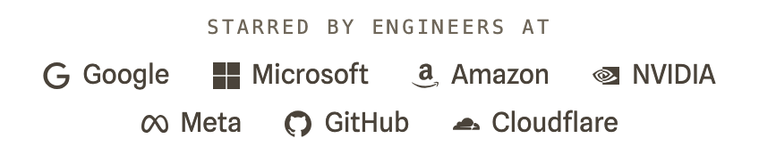
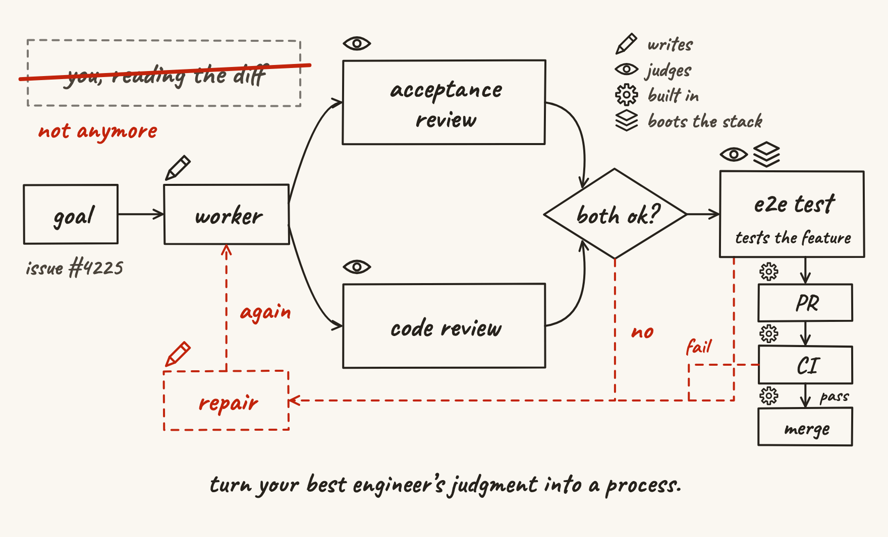

<div align="center">

# zeroshot

**An open-source engine for autonomous software production.**

[zeroshot.sh](https://zeroshot.sh/?utm_source=github&utm_medium=readme&utm_campaign=zeroshot) · [Discord](https://theopenengine.com/discord) · [Docs](https://zeroshot.sh/docs/) · [Blog](https://theopenengine.com/blog/)

[](https://github.com/the-open-engine/zeroshot/releases/latest)
[](https://github.com/the-open-engine/zeroshot/actions/workflows/ci.yml?query=branch%3Amain)
[](LICENSE)

&nbsp;

<picture><source media="(prefers-color-scheme: dark)" srcset="docs/brand/social/starred-by-dark.png"></picture>

</div>

Turn your team's development and QA process into a graph that agents execute. Define who builds,
what gets checked, where rejected work goes, and what must pass before delivery. Reuse that process
across tasks, with the agents and models you choose.

Think CI starting at the issue. The engine owns the execution order and allowed transitions. Agents
do the work and make the judgments. Model output can't add an edge or raise a retry bound.

## Your engineering process, executable

A task can move through implementation, independent review, repairs, and delivery without you
coordinating each handoff. The graph defines the process, including parallel work, conditional
reviews, and bounded repair loops.

For example, a graph for a team that requires extra review for sensitive changes might look like
this.

```text
worker ◄─────────── any "no" ────┐
  ▼                              │
risk check                       │
  ├─ auth, payments, migration?  │
  │    ▼                         │
  │  security review ─────── no ─┤
  ▼    ▼                         │
acceptance + code review ─── no ─┘
  ▼ both yes
deliver
```

Ask for a CSV export, and the worker implements it. If acceptance review finds that the export
includes another user's data, the rejection goes back to the worker. The revised change goes
through the reviews again. This example delivers only after its required reviews approve, and
stops if the configured repair bound is exhausted.

Reviewers start in a fresh session and can run a different model. Independent review matters. In
[our study](https://theopenengine.com/blog/review-loop/), all 100 sessions told to check their own
work stopped after one pass.

This is one graph you can build. Shape the roles, checks, branches, and repair paths around your
repo's requirements, then save the process as a reusable profile. Delivery can keep accepted work
local, push a branch, open a PR, or take it through CI and review feedback to a merge.

See the difference on zeroshot.sh: [a flight game](https://zeroshot.sh/#flight-demo) and
[a landing page](https://zeroshot.sh/#design-reviewer), each built by an agent alone and again through
a zeroshot graph.

## Who is this for?

- Senior engineers who care about correctness and reproducibility
- Teams automating PR workflows and code review gates
- Infra/platform teams standardizing agentic workflows
- Open-source maintainers working through issue backlogs
- AI power users who want verification, not vibes

## Get started

Install it once:

```bash
npm install -g @the-open-engine-company/zeroshot
```

This also installs the zeroshot skills for Claude Code, Codex, Copilot CLI and Pi. Open one of them
in your repo and ask:

```text
Use the zeroshot-graph-design skill to turn how we check changes
in this repo into a zeroshot graph.
```

It reads your build, test and CI setup, asks how you want changes delivered, and shows you the graph
and every agent's instructions before saving anything. Then it asks which models to use and saves the
graph, as your default if you want.

Then plan the work before you hand it over:

```text
plan this with zeroshot: let users export their data as CSV
```

Your agent reads the code, asks only what changes the outcome, and writes a plan where every
acceptance criterion comes with a check: a test, a command or an end-to-end scenario. You decide what
done means. Then:

```text
zeroshot it
```

The worker builds from the plan and the reviewers judge the result against those criteria. When the
run finishes, your agent tells you what got rejected and what got fixed. Watch it live with
`zeroshot ui`.

The graph also decides where finished work goes: kept local, pushed as a branch, opened as a PR,
or taken through your CI and review comments to a merge.

<p align="center">
  <a href="https://zeroshot.sh/?utm_source=github&amp;utm_medium=readme&amp;utm_campaign=zeroshot#one-graph">
    <picture>
      <source media="(prefers-reduced-motion: reduce) and (max-width: 640px) and (prefers-color-scheme: dark)" srcset="docs/assets/example-graph-tall-dark.png">
      <source media="(prefers-reduced-motion: reduce) and (max-width: 640px)" srcset="docs/assets/example-graph-tall-light.png">
      <source media="(prefers-reduced-motion: reduce) and (prefers-color-scheme: dark)" srcset="docs/assets/example-graph-wide-dark.png">
      <source media="(prefers-reduced-motion: reduce)" srcset="docs/assets/example-graph-wide-light.png">
      <source media="(max-width: 640px) and (prefers-color-scheme: dark)" srcset="docs/assets/example-graph-tall-dark.gif">
      <source media="(max-width: 640px)" srcset="docs/assets/example-graph-tall-light.gif">
      <source media="(prefers-color-scheme: dark)" srcset="docs/assets/example-graph-wide-dark.gif">
      
    </picture>
  </a>
</p>

Runs happen on your machine with the login your agent already uses, subscriptions included. The CLI
is free and MIT licensed.

## Skills

`npm install` adds four skills to Claude Code (`~/.claude/skills`) and to Codex, Copilot CLI and Pi
(`~/.agents/skills`). Ask for them by name, or just say what you want.

Set `ZEROSHOT_SKIP_SKILLS=1` for npm installation and `zeroshot update` to skip user-scope skill
installation. Export it in your shell configuration to keep future updates from recreating removed
skills; existing skill files stay untouched. See the [install guide](docs/getting-started/install.md).

| Skill                   | What it does                                                            | Try                                     |
| ----------------------- | ----------------------------------------------------------------------- | --------------------------------------- |
| `zeroshot-graph-design` | Reads your repo, asks a few questions, designs the graph, saves it      | "design a zeroshot graph for this repo" |
| `zeroshot-plan`         | Turns an idea or issue into a plan with checkable acceptance criteria   | "plan this with zeroshot: ..."          |
| `zeroshot`              | Starts, follows and troubleshoots runs, locally or on zeroshot Platform | "zeroshot it"                           |
| `zeroshot-memory-init`  | Builds Active Memory from your past local runs                          | "initialize zeroshot memory"            |

## Run it for the whole team

Ask your agent to save the graph to [zeroshot Platform](https://app.zeroshot.sh/docs) instead, and
everyone's tasks go through the same process. Platform runs work in parallel, off your laptops, on
your own model API keys.

To keep execution on your own infrastructure, run the Docker target:

```bash
docker run --detach --restart unless-stopped --name zeroshot-target \
  -p 127.0.0.1:8080:8080 \
  -v zeroshot-data:/var/lib/zeroshot \
  ghcr.io/the-open-engine/zeroshot-target:latest

zeroshot target add local --url http://127.0.0.1:8080 --direct
```

## Architecture

zeroshot is an engine that runs a graph of coding agents and owns the control flow.

- The graph says which agents run, in what order, what each must return, and where results go.
- Admission checks the graph, its bounds, the runtime plan and the input before anything runs.
- The engine runs a node, checks its typed output, records it, then picks the next edge. Model
  output can't add an edge or raise a bound.
- Each node runs on its own harness and model through an adapter.
- Every event lands in a durable ledger, so a crashed run can resume.

```text
your agent + zeroshot skills
      │
      ▼
zeroshot CLI ── checks the graph
      │         before anything runs
      ▼
target ──────── local · Docker · Platform
      │
      ▼
engine ──────── runs a node, checks its
      │         output, picks the next edge
      ├──▶ harness adapters: Claude Code,
      │    Codex, Copilot CLI, Pi
      ├──▶ durable ledger: resumable runs
      └──▶ delivery: local, branch, PR, merge
```

## Command reference

The easiest way to use zeroshot is through your agent: the skills run these commands for you. For
scripts, CI or debugging:

```bash
# Run
zeroshot run --title "Add CSV export" --profile local:my-graph --input input.json
zeroshot run --title "Add CSV export" --profile local:my-graph --input input.json --validate-only

# Follow
zeroshot list
zeroshot status RUN_ID
zeroshot watch RUN_ID
zeroshot logs RUN_ID
zeroshot ui                  # browser UI at http://127.0.0.1:4173/ui/

# Control
zeroshot resume RUN_ID
zeroshot force-stop RUN_ID

# Graphs and profiles
zeroshot template list
zeroshot template show software-change
zeroshot profile list
zeroshot profile set my-graph --graph graph.json --runtime-config runtime.json
zeroshot profile default my-graph

# Targets
zeroshot target login platform
zeroshot target add my-target --url https://zeroshot.example.com
```

Every command and flag is in the [CLI reference](docs/zeroshot-cli.md).

## What users say

> I used Zeroshot for my last two contracts: a production line automation and control
> system, and a multi-host sync and admin system for Webflow and Guesty. Very happy with it!
>
> — Mark Dingwall

> you guys are solving this in a way that is more satisfying than the google ADK (to me) and it’s
> fuckin google.
>
> — Fav

Talk to the founders and power users in [Discord](https://theopenengine.com/discord).

## Docs

- [Build a review loop](docs/guides/review-loop.md): a complete graph with two reviewers and a repair loop
- [Graph contract](docs/reference/cluster/graph.md)
- [Delivery to GitHub and GitLab](docs/guides/forge-delivery.md): `software-change` defaults to PR delivery.
  Runs can also stay local, push a branch or merge.
- [Auto-research](docs/concepts/execution.md#built-in-templates-are-ordinary-graphs) and
  [Active Memory](docs/guides/active-memory.md)
- [CLI reference](docs/zeroshot-cli.md) and [first run from the CLI](docs/getting-started/first-run.md)
- [Target image guide](docker/zeroshot-target/README.md), [Python SDK](sdks/python/README.md),
  [Cluster API](https://zeroshot.sh/docs/current/reference/cluster/api/)

[Opcore](https://github.com/the-open-engine/opcore) gives coding agents feedback on each edit while
they write code.

## Community

Ask questions or join as a contributor in [Discord](https://theopenengine.com/discord). Report bugs
in [GitHub Issues](https://github.com/the-open-engine/zeroshot/issues).

## Development

```bash
npm ci
npm run check
cargo test --workspace # Unix; Windows: powershell -NoProfile -File scripts/test-windows.ps1
```

See [UI development](ui/README.md), [CONTRIBUTING.md](CONTRIBUTING.md),
[PUBLISHING.md](PUBLISHING.md) and [SECURITY.md](SECURITY.md).

## License

MIT. See [LICENSE](LICENSE).
