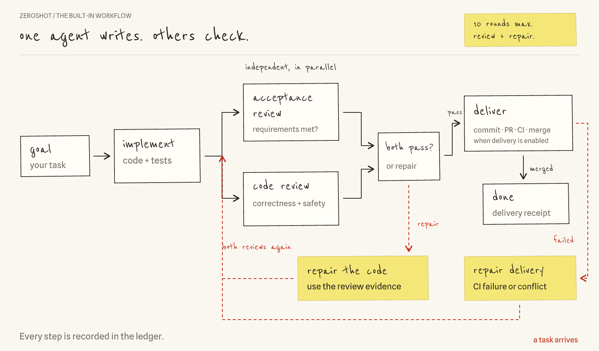

<div align="center">

<picture>
  <source media="(max-width: 640px)" srcset="docs/brand/zeroshot-hero-mobile.png">
  <source media="(prefers-color-scheme: dark)" srcset="docs/brand/zeroshot-hero-dark.png">
  
</picture>

&nbsp;

<a href="https://theopenengine.com/discord"><picture><source media="(prefers-color-scheme: dark)" srcset="docs/brand/social/discord-cta-dark.png"></picture></a>
<a href="https://zeroshot.sh/?utm_source=github&utm_medium=readme&utm_campaign=zeroshot"><picture><source media="(prefers-color-scheme: dark)" srcset="docs/brand/social/zeroshot-site-dark.png"></picture></a>
<a href="https://theopenengine.com/?utm_source=github&utm_medium=readme&utm_campaign=zeroshot"><picture><source media="(prefers-color-scheme: dark)" srcset="docs/brand/social/website-dark.png"></picture></a>
<a href="https://x.com/OpenEngineHQ"><picture><source media="(prefers-color-scheme: dark)" srcset="docs/brand/social/x-dark.png"></picture></a>
<a href="https://www.linkedin.com/company/the-open-engine-company"><picture><source media="(prefers-color-scheme: dark)" srcset="docs/brand/social/linkedin-dark.png"></picture></a>

[](https://github.com/the-open-engine/zeroshot/releases/latest)
[](https://www.npmjs.com/package/@the-open-engine-company/zeroshot)
[](https://github.com/the-open-engine/zeroshot/actions/workflows/ci.yml?query=branch%3Amain)
[](https://github.com/the-open-engine/zeroshot/actions/workflows/opcore.yml?query=branch%3Amain)
[](https://coveralls.io/github/the-open-engine/zeroshot?branch=main)
[](https://zeroshot.sh/docs/)
[](LICENSE)

&nbsp;

<a href="https://github.com/the-open-engine/zeroshot/stargazers"><picture><source media="(prefers-color-scheme: dark)" srcset="docs/brand/social/starred-by-dark.png"></picture></a>

</div>

# zeroshot

**Build your own open-source software factory.**

Turn a task into a reviewed pull request through a workflow you control. Choose the agents and
models, define what must pass, and decide where rejected work goes for repair.

Start with the built-in `software-change` graph: implementation → independent review → repair →
optional delivery. Or design your own topology. Add security reviewers, test agents, and parallel checks,
then save the workflow as a profile and reuse it.

The agent that writes the code cannot approve its own work. The engine enforces the graph's review
gates and retry limits. Think of it as CI for coding agents, starting before the code is written.
zeroshot runs Claude Code, Codex, or Copilot as the worker and reviewers, with a separate harness
and provider available for each agent.

The CLI is free and MIT licensed. Run locally, [self-host](#self-hosted-run-the-docker-target), or
use [zeroshot Cloud](https://cloud.zeroshot.sh/docs).

<div align="center">
  <picture>
    <source media="(prefers-reduced-motion: reduce)" srcset="docs/assets/zeroshot-workflow.svg">
    <source media="(prefers-color-scheme: dark)" srcset="docs/assets/zeroshot-demo-dark.gif">
    
  </picture>
  <br>
  <em>Workflow illustration: both reviews run again after a repair. Git delivery is optional.</em><br>
  <a href="docs/assets/zeroshot-workflow.svg">Static diagram</a>
</div>

We want to explore how much task decomposition and validation loops can narrow the gap between
open models and closed frontier systems. The graph, review rules, and repair paths are open for
anyone to inspect, change, and test on real work.

**[▶ Video: a single agent vs. zeroshot](https://x.com/eivindmeyer_cv/status/2106898797771288828)** (scripted)

Questions, ideas, or a run worth showing? Join the [zeroshot community on Discord](https://theopenengine.com/discord).

## Get started

Prefer Cloud? [Cloud setup →](https://cloud.zeroshot.sh/docs)

### Run locally

```bash
npm install -g @the-open-engine-company/zeroshot
```

The installer requires Node.js 18 or newer and installs a verified native binary for Linux
x64/arm64, macOS x64/arm64, or Windows x64. It also installs one zeroshot skill for Codex, GitHub
Copilot, and Claude Code at user scope.

For local execution, install and sign in to Codex, Claude Code, or GitHub Copilot. Local runs can
reuse the harness's existing login, including subscription-backed sessions. See the
[installation guide](docs/getting-started/install.md) for harness prerequisites.

#### Run your first task

This example uses Codex and keeps delivery local. **The worker edits the current Git worktree**,
so start in a clean worktree intended for the task.

Create `input.json`, replacing the example task with a change appropriate for your repository:

```json
{
  "task": "Add JSON output to the status command and cover it with focused tests."
}
```

Create `runtime.json`. Replace `YOUR_MODEL_ID` with a model identifier supported by your installed
Codex CLI:

```json
{
  "harness": "codex",
  "provider": "openai",
  "model": "YOUR_MODEL_ID",
  "effort": "high"
}
```

Start the run. Add `--validate-only` to check the graph, runtime configuration, and input first:

```bash
zeroshot run \
  --title "Add JSON status output" \
  --template software-change \
  --input input.json \
  --uniform-runtime-config runtime.json
```

Open another terminal to inspect the run:

```bash
zeroshot ui
```

Visit `http://127.0.0.1:4173/ui/` and open **Runs**. Stopping the UI server leaves active runs
running. The CLI also provides `zeroshot list`, `zeroshot status RUN_ID`, and `zeroshot logs RUN_ID`.

For other harnesses and providers, see [Runtimes and connections](docs/concepts/runtimes-and-connections.md).

### Run in the cloud

Connect GitHub and bring your own model API keys.
[Cloud setup guide →](https://cloud.zeroshot.sh/docs)

## What the built-in workflow does

1. A worker implements the task.
2. Acceptance and code reviewers check the result independently, in parallel.
3. Rejected work goes to one repair worker with both reviews' feedback, then through both reviews
   again.
4. With delivery enabled, accepted work proceeds through the configured Git and CI steps.
5. Delivery conflicts return through repair and review.

The graph defines the sequence, parallel steps, retry paths, and exit conditions before execution
starts. Runs are bounded, and events are recorded in a durable SQLite ledger. A passing run means
its configured checks accepted the work; coverage depends on the requirements, reviewers, tests,
and environment you provide.

## Auto-research

The built-in `auto-research` template runs ten iterations by default; set a positive
`options.iterations` value in the run input to choose another count. Three scouts propose
directions, then a planner chooses an experiment and either the current candidate or a restorable
archived candidate as its starting point. Independent judges check the evidence and method, while
the progress judge decides whether the result should replace the current candidate under the task
charter. A valid result can go into the archive without replacing it. An auditor checks the ledger,
archive, and workspace before the next iteration.

Inspect the graph with `zeroshot template show auto-research`.

## Bring your own graph topology

Choose each agent's model and instructions, which steps run in parallel, and when to retry.
Example topology, adding stages after the review loop:

```text
Implementation
      ↓
Code review + acceptance review
      ↓
Bugfinder: adversarial tests
      ↓
E2E tests
      ↓
Delivery
```

The software-change review loop, auto-research graph, and delivery are built in. You define other
stages, their tools, services and credentials, and where failures go for repair.

Inspect the built-in graph as a starting point:

```bash
zeroshot template show software-change
```

See the [graph contract](docs/reference/cluster/graph.md) for custom graph authoring and
[Prepare a runtime environment](docs/guides/runtime-environments.md) for dependency and service setup.

## Save and reuse a profile

Each step can use its own model. Pass `--runtime-config` with one binding per node in place of
`--uniform-runtime-config`:

```json
{
  "harness": "claude",
  "provider": "anthropic",
  "size": "medium",
  "nodes": {
    "worker": { "kind": "agent", "model": "WORKER_MODEL_ID", "effort": "high", "sessionScope": "node_instance" },
    "acceptance": { "kind": "agent", "model": "REVIEW_MODEL_ID", "effort": "high" },
    "code": { "kind": "agent", "model": "REVIEW_MODEL_ID", "effort": "max" }
  }
}
```

The same worker handles implementation, review repairs, and delivery repairs in one session.
Both reviewers start fresh on every pass. Run `zeroshot template show software-change` to list
the node names. See the
[RuntimePlan reference](docs/reference/runtime-plan.md) for every field.

A profile stores a graph and its runtime settings. Use **Profiles** in the browser UI to edit and
save your configuration. Keep different profiles for different kinds of work, or reuse one for the
next task.

Once you've saved a local profile named `my-profile`, run another task with it:

```bash
zeroshot run \
  --title "My next task" \
  --profile local:my-profile \
  --input input.json
```

The CLI and UI share the same local profiles. See
[UI setup](docs/getting-started/install.md#open-the-workspace-ui).

## Choose delivery and execution

Keep the first result local, then enable the delivery mode that fits your process:

| Delivery         | Behavior                                         |
| ---------------- | ------------------------------------------------ |
| No delivery flag | Keep the work local                              |
| `--push`         | Push the managed branch                          |
| `--pr`           | Prepare a mergeable pull request without merging |
| `--ship`         | Proceed through PR, CI, and merge                |

PR and ship runs address visible pull request review feedback by default; pass `--no-pr-feedback` to
ignore it.

Graphs can execute locally or on a self-hosted target. Each environment needs its own tools and
authentication setup.

### Self-hosted: run the Docker target

Keep execution and durable state on infrastructure you control. The target image includes the native
engine plus pinned Codex, Claude, and GitHub Copilot harness CLIs.

```bash
docker run --detach --restart unless-stopped --name zeroshot-target \
  -p 127.0.0.1:8080:8080 \
  -v zeroshot-data:/var/lib/zeroshot \
  ghcr.io/the-open-engine/zeroshot-target:latest

zeroshot target add local --url http://127.0.0.1:8080 --direct
```

The target also serves its profile editor and run viewer at `http://127.0.0.1:8080/ui/`.

See the [target image guide](docker/zeroshot-target/README.md) for persistent storage, network
isolation, builds, and HTTPS.

A failed run with a recoverable workspace can be
[restarted or resumed](docs/guides/observe-and-control.md#restart-or-resume-a-failed-run).

## Research graph

zeroshot also includes an `auto-research` graph for ten bounded iterations of experiments with
independent review of evidence, method, and progress. It keeps adopted, record-only, and aborted
results under `.zeroshot/research`; add `--push` when each finalized iteration should be published.

```bash
zeroshot template list
zeroshot template show auto-research
```

See [Execution](docs/concepts/execution.md) for the research workflow's decision and evidence rules.

## Community

- [Discord](https://theopenengine.com/discord): ask questions, share runs and graphs, and talk to the team.
- [GitHub Issues](https://github.com/the-open-engine/zeroshot/issues): reproducible bugs and feature requests.

## Reference

- [Versioned documentation](https://zeroshot.sh/docs/)
- [Get started](docs/getting-started/first-run.md)
- [CLI reference](docs/zeroshot-cli.md)
- [Target image guide](docker/zeroshot-target/README.md)
- [Python SDK](sdks/python/README.md)
- [Cluster API reference](https://zeroshot.sh/docs/current/reference/cluster/api/)
- [Graph contract](docs/reference/cluster/graph.md)

Also check out: [Opcore](https://github.com/the-open-engine/opcore).

## Development

```bash
npm ci
npm run check
cargo test --workspace # Unix; Windows: powershell -NoProfile -File scripts/test-windows.ps1
```

Node.js builds the static UI and supports repository tooling and npm delivery; Rust serves the UI.
See [UI development](ui/README.md),
[CONTRIBUTING.md](CONTRIBUTING.md), [PUBLISHING.md](PUBLISHING.md), and [SECURITY.md](SECURITY.md).

## License

MIT. See [LICENSE](LICENSE).
