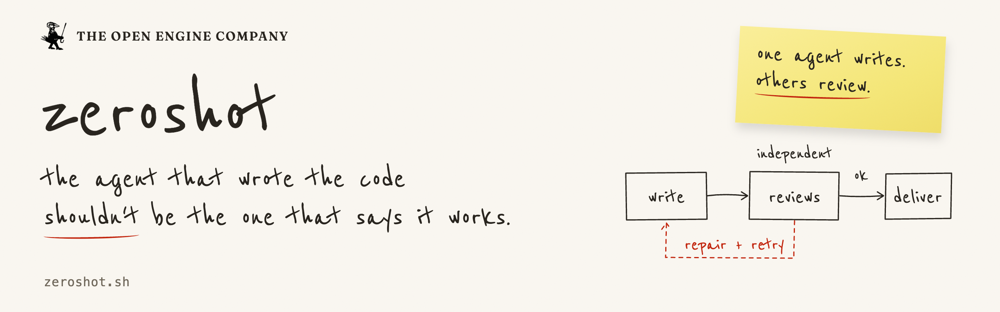
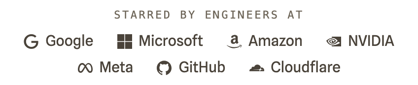
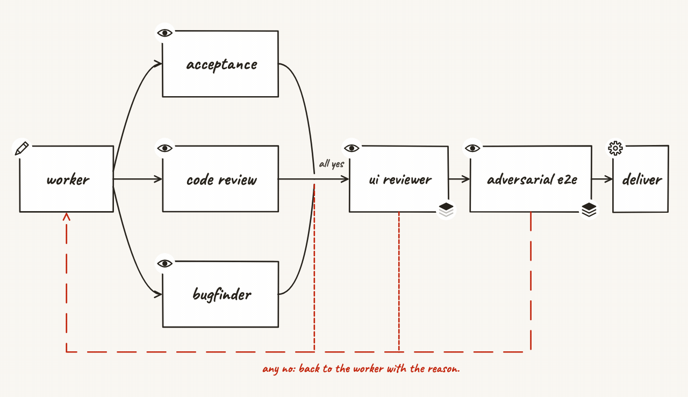
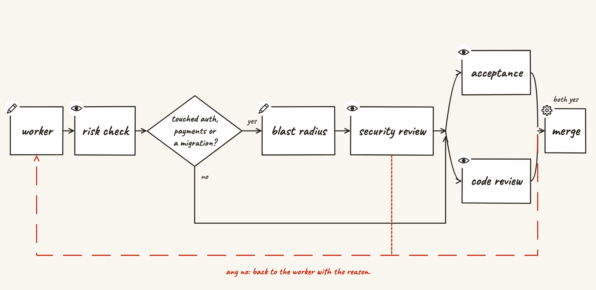

<div align="center">

<picture>
  <source media="(max-width: 640px)" srcset="docs/brand/zeroshot-hero-mobile.png">
  <source media="(prefers-color-scheme: dark)" srcset="docs/brand/zeroshot-hero-dark.png">
  
</picture>

&nbsp;

<a href="https://theopenengine.com/discord"><picture><source media="(prefers-color-scheme: dark)" srcset="docs/brand/social/discord-cta-dark.png"></picture></a>
<a href="https://zeroshot.sh/?utm_source=github&utm_medium=readme&utm_campaign=zeroshot"><picture><source media="(prefers-color-scheme: dark)" srcset="docs/brand/social/zeroshot-site-dark.png"></picture></a>
<a href="https://theopenengine.com/?utm_source=github&utm_medium=readme&utm_campaign=zeroshot"><picture><source media="(prefers-color-scheme: dark)" srcset="docs/brand/social/website-dark.png"></picture></a>
<a href="https://x.com/OpenEngineHQ"><picture><source media="(prefers-color-scheme: dark)" srcset="docs/brand/social/x-dark.png"></picture></a>
<a href="https://www.linkedin.com/company/the-open-engine-company"><picture><source media="(prefers-color-scheme: dark)" srcset="docs/brand/social/linkedin-dark.png"></picture></a>

[](https://github.com/the-open-engine/zeroshot/releases/latest)
[](https://www.npmjs.com/package/@the-open-engine-company/zeroshot)
[](https://github.com/the-open-engine/zeroshot/actions/workflows/ci.yml?query=branch%3Amain)
[](https://github.com/the-open-engine/zeroshot/actions/workflows/opcore.yml?query=branch%3Amain)
[](https://coveralls.io/github/the-open-engine/zeroshot?branch=main)
[](https://zeroshot.sh/docs/)
[](LICENSE)

&nbsp;

<a href="https://github.com/the-open-engine/zeroshot/stargazers"><picture><source media="(prefers-color-scheme: dark)" srcset="docs/brand/social/starred-by-dark.png"></picture></a>

</div>

# zeroshot

**Stop babysitting your agents.**

Prompts are suggestions. Graphs are enforced.

A skill can ask for a review, but the agent decides whether to listen. In a zeroshot graph, your QA
process is enforced by code.

zeroshot runs coding, independent review and repairs through the workflow you define.

Choose the agents and models, define what must pass, and decide where rejected work goes for
repair.

The engine enforces the graph’s review gates and retry limits. Each agent can use its own model and
harness (Pi, Claude Code, Codex or Copilot).

On 20 ProgramBench tasks, [a small model in a zeroshot loop](https://theopenengine.com/blog/review-loop/)
matched a larger model's score at a median 58% of its cost. More examples on zeroshot.sh:
[a flight game](https://zeroshot.sh/#flight-demo), [a landing page](https://zeroshot.sh/#design-reviewer)
and [a research run](https://zeroshot.sh/#not-just-coding).

The CLI is free and MIT licensed. Run locally, [self-host](#self-hosted-run-the-docker-target), or
use [Zeroshot Platform](https://app.zeroshot.sh/docs).

<div align="center">
  <a href="https://zeroshot.sh/#topology">
    <picture>
      <source media="(prefers-reduced-motion: reduce) and (max-width: 640px)" srcset="docs/assets/product-graph-feature-mobile.png">
      <source media="(prefers-reduced-motion: reduce)" srcset="docs/assets/product-graph-feature-wide.png">
      <source media="(max-width: 640px)" srcset="docs/assets/product-graph-feature-mobile.gif">
      
    </picture>
  </a>
  <br>
  <em>Example custom workflow. <a href="https://zeroshot.sh/#topology">Explore the interactive graphs.</a></em>
</div>

## What users say

> I used Zeroshot (my fork) for my last two contracts: a production line automation and control
> system, and a multi-host sync and admin system for Webflow and Guesty. Very happy with it!
>
> — Mark Dingwall

> Generally, I’m really happy with the results and the quality. I really like the mental models of
> creating profiles.
>
> — Daniel Graungaard

> Implemented support of pi.dev harness and it works pretty well (built with zeroshot BTW).
>
> — Andrey

> you guys are solving this in a way that is more satisfying than the google ADK (to me) and it’s
> fuckin google.
>
> — Fav

## Get started

### Run locally

```bash
npm install -g @the-open-engine-company/zeroshot
```

Paste this into Claude Code or Codex in your repo:

```text
Use the zeroshot skill to set up a local run for a small issue in this repo.
Work on a fresh branch and stop if there are uncommitted changes.
Show me the task and workflow before starting.
Once I approve, run it, monitor progress, and summarize the result.
```

The installer requires Node.js 18 or newer and installs a verified native binary for Linux
x64/arm64, macOS x64/arm64, or Windows x64. It also installs agent skills for Codex, GitHub
Copilot, Pi, and Claude Code at user scope.

For local execution, install and sign in to Codex, Claude Code, GitHub Copilot, or Pi. Local runs can
reuse the harness's existing login, including subscription-backed sessions. See the
[installation guide](docs/getting-started/install.md) for harness prerequisites.

#### Run directly from the CLI

This example uses Codex and keeps delivery local. **The worker edits the selected folder**;
Git is optional. Add `--cwd FOLDER` to select another folder; input files stay relative to the invoking folder.

Create `input.json` with a task for your project:

```json
{
  "task": "Add JSON output to the status command and cover it with focused tests."
}
```

Create `runtime.json`. Replace `YOUR_MODEL_ID` with a model identifier supported by your installed
Codex CLI:

```json
{
  "harness": "codex",
  "provider": "openai",
  "model": "YOUR_MODEL_ID",
  "effort": "high"
}
```

Start the run. Add `--validate-only` to check the graph, runtime configuration, and input first:

```bash
zeroshot run \
  --title "Add JSON status output" \
  --template software-change --delivery none \
  --input input.json \
  --uniform-runtime-config runtime.json
```

Open another terminal to inspect the run:

```bash
zeroshot ui
```

Visit `http://127.0.0.1:4173/ui/` and open **Runs**. Stopping the UI server leaves active runs
running. The CLI also provides `zeroshot list`, `zeroshot status RUN_ID`, and `zeroshot logs RUN_ID`.
A failed run with a recoverable workspace can be
[restarted or resumed](docs/guides/observe-and-control.md#restart-or-resume-a-failed-run).

For other harnesses and providers, see [Runtimes and connections](docs/concepts/runtimes-and-connections.md).

### Run on Zeroshot Platform

Connect GitHub and bring your own model API keys.
[Platform setup guide →](https://app.zeroshot.sh/docs)

## Build your own graph

Choose each agent's model and instructions, which steps run in parallel, and when to retry.
This example routes changes to auth, payments, or migrations through a blast-radius map and security
review before acceptance and code review. Other changes go straight to review.

<a href="https://zeroshot.sh/#topology">
<picture>
  <source media="(max-width: 640px)" srcset="docs/assets/product-graph-danger-mobile.png">
  
</picture>
</a>

The software-change review loop, auto-research graph, and delivery are built in. You define other
stages, their tools, services and credentials, and where failures go for repair.

Inspect the built-in graph as a starting point:

```bash
zeroshot template show software-change
```

Start with [Build a review loop](docs/guides/review-loop.md), a complete example with two independent
reviewers and a repair loop. Adapt the reviewers’ instructions to your project. See the
[graph contract](docs/reference/cluster/graph.md) for supported graph structures and
[Prepare a runtime environment](docs/guides/runtime-environments.md) for dependency and service setup.

## Save and reuse a profile

Each step can use its own model. Pass `--runtime-config` with one binding per node in place of
`--uniform-runtime-config`:

```json
{
  "harness": "claude",
  "provider": "anthropic",
  "size": "medium",
  "nodes": {
    "worker": {
      "kind": "agent",
      "model": "WORKER_MODEL_ID",
      "effort": "high",
      "sessionScope": "node_instance"
    },
    "acceptance": { "kind": "agent", "model": "REVIEW_MODEL_ID", "effort": "high" },
    "code": { "kind": "agent", "model": "REVIEW_MODEL_ID", "effort": "max" }
  }
}
```

The same worker handles implementation, review repairs, and delivery repairs in one session.
Both reviewers start fresh on every pass. Run `zeroshot template show software-change` to list
the node names. See the
[RuntimePlan reference](docs/reference/runtime-plan.md) for every field.

A profile stores a graph and its runtime settings. Use **Profiles** in the browser UI to edit and
save your configuration.

Once you've saved a local profile named `my-profile`, run another task with it:

```bash
zeroshot run \
  --title "My next task" \
  --profile local:my-profile \
  --input input.json
```

The CLI and UI share the same local profiles. See
[UI setup](docs/getting-started/install.md#open-the-workspace-ui). For shared team configurations,
see [organization profiles](https://app.zeroshot.sh/docs/connections-and-profiles).

## What the built-in workflow does

1. A worker implements the task.
2. Acceptance and code reviewers check the result independently, in parallel.
3. Rejected work returns to the same worker with both reviews' feedback, then through both reviews
   again.
4. With delivery enabled, accepted work proceeds through the configured Git and CI steps.
5. Delivery conflicts return through repair and review.

The graph defines the sequence, parallel steps, retry paths, and exit conditions before execution
starts. Runs are bounded, and events are recorded in a durable SQLite ledger. A passing run means
its configured checks accepted the work; coverage depends on the requirements, reviewers, tests,
and environment you provide.

[Active Memory](docs/guides/active-memory.md) recalls lessons from costly mistakes in local and Docker
runs; [backfill from history](docs/guides/active-memory.md#initialize-from-local-history).

## Auto-research

The built-in `auto-research` template runs ten iterations by default; set a positive
`options.iterations` value in the run input to choose another count. Three independent scouts
propose directions. One researcher chooses a parent and experiment, runs it, and prepares the
retained result. A fresh reviewer checks the evidence, correctness, generalization, and progress.
Required corrections return to the same researcher session; small archive or bookkeeping issues
are advisory. A normal round uses five model executions.

The scouts and researcher retain their own sessions across rounds by default. Compact records and
restorable candidates live at the workspace root's `.zeroshot/research`; later rounds can revisit
archived ideas. Add `--push` to publish each independently accepted round. Inspect the graph with
`zeroshot template show auto-research`, and see [Execution](docs/concepts/execution.md) for its
review and exploration rules.

## Choose delivery and execution

`software-change` defaults to PR delivery; `pr-review` and `issue-review` default to posting a comment.
[PR review](docs/guides/review.md) classifies reproduction needs, exercises the full local stack when
required, and checks code and linked issue coverage before posting a concise report.
Use `--delivery none` to keep a software change local or return an issue review report without publication.
For `software-change`:

| Delivery          | Behavior                                         |
| ----------------- | ------------------------------------------------ |
| No delivery flag  | Prepare a mergeable pull request without merging |
| `--delivery none` | Keep the work local                              |
| `--push`          | Push the managed branch                          |
| `--pr`            | Prepare a mergeable pull request without merging |
| `--ship`          | Proceed through PR, CI, and merge                |

PR and ship runs address visible pull request review feedback by default; pass `--no-pr-feedback` to
ignore it.

Push needs a committed Git checkout and an HTTPS or SSH remote. PR and ship additionally need a
forge adapter; GitHub is maintained today. Local GitHub PR and ship runs also need the GitHub CLI
(`gh`) on `PATH`. Docker and Platform runs require an exact Git source.
See [targets and source credentials](docs/concepts/targets.md) for setup.

### Self-hosted: run the Docker target

Keep execution and durable state on infrastructure you control. The target image includes the native
engine plus pinned Codex, Claude, GitHub Copilot, and Pi harness CLIs.

```bash
docker run --detach --restart unless-stopped --name zeroshot-target \
  -p 127.0.0.1:8080:8080 \
  -v zeroshot-data:/var/lib/zeroshot \
  ghcr.io/the-open-engine/zeroshot-target:latest

zeroshot target add local --url http://127.0.0.1:8080 --direct
```

The target also serves its profile editor and run viewer at `http://127.0.0.1:8080/ui/`.

See the [target image guide](docker/zeroshot-target/README.md) for persistent storage, network
isolation, builds, and HTTPS.

## Community

- [Discord](https://theopenengine.com/discord): ask questions, share runs and graphs, and talk to the team.
- [GitHub Issues](https://github.com/the-open-engine/zeroshot/issues): reproducible bugs and feature requests.

## Reference

- [Versioned documentation](https://zeroshot.sh/docs/)
- [Get started](docs/getting-started/first-run.md)
- [CLI reference](docs/zeroshot-cli.md)
- [Target image guide](docker/zeroshot-target/README.md)
- [Python SDK](sdks/python/README.md)
- [Cluster API reference](https://zeroshot.sh/docs/current/reference/cluster/api/)
- [Graph contract](docs/reference/cluster/graph.md)

[Opcore](https://github.com/the-open-engine/opcore) gives coding agents feedback on each edit while
they write code.

## Development

```bash
npm ci
npm run check
cargo test --workspace # Unix; Windows: powershell -NoProfile -File scripts/test-windows.ps1
```

Node.js builds the static UI and supports repository tooling and npm delivery; Rust serves the UI.
See [UI development](ui/README.md),
[CONTRIBUTING.md](CONTRIBUTING.md), [PUBLISHING.md](PUBLISHING.md), and [SECURITY.md](SECURITY.md).

## License

MIT. See [LICENSE](LICENSE).
