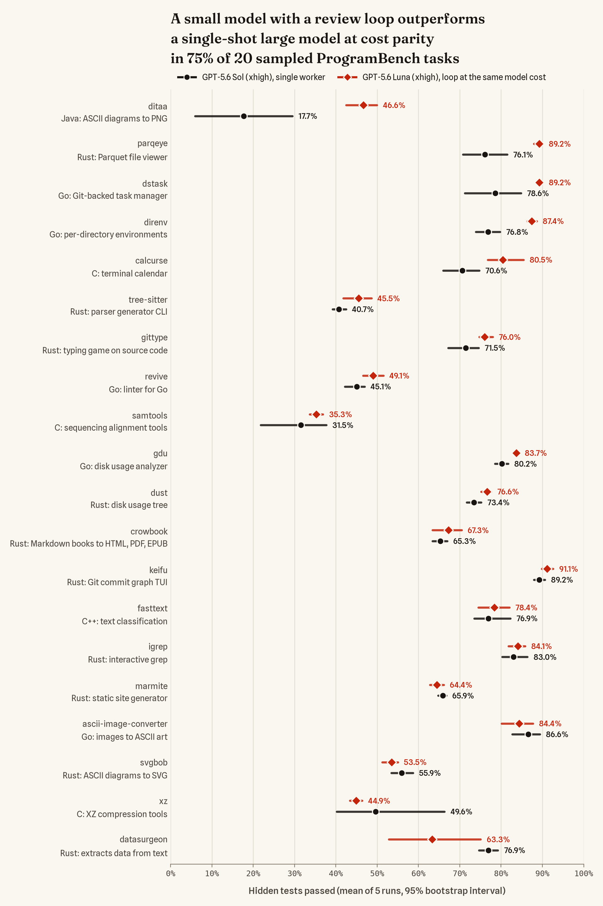
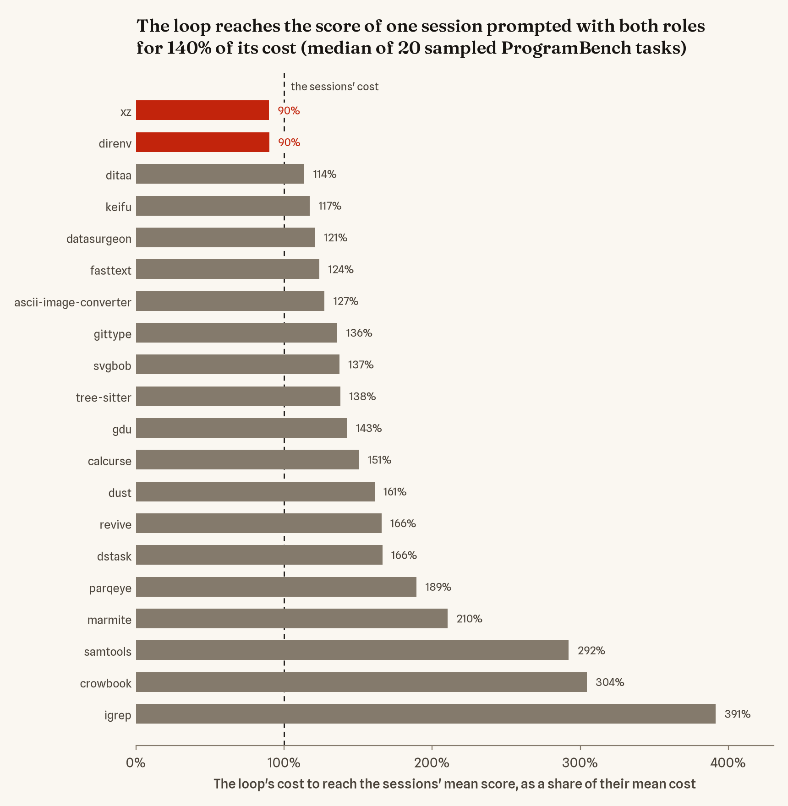

# Zeroshot on ProgramBench

A reproducible, fully containerized benchmark of a minimal review loop on
[ProgramBench](https://github.com/facebookresearch/ProgramBench): rebuild a program from its
compiled reference executable and documentation, offline, then score the rebuild with
ProgramBench's hidden behavioral tests. The loop is a two-node Zeroshot graph: a builder, and an
independent checker whose rejection becomes the builder's feedback for the next round.

## Questions

1. **Cost parity.** Can a cheaper model's check-and-repair loop beat a more expensive model's single
   worker at the same model cost? GPT-5.6 Luna at `xhigh` ($0.20 input, $1.20 output per million
   tokens) runs the loop; GPT-5.6 Sol at `xhigh` ($4 and $20) runs once, as a single worker. The dual
   question: how much does the loop cost to reach the single worker's score?
2. **Prompt study.** Is the loop's benefit the topology, or would the same instructions in one session
   do as well? GPT-5.6 Luna runs once per attempt with a prompt that quotes both roles and asks the
   model to alternate between them.
3. **Checker session.** Does the loop need a checker that starts fresh every round? The same loop runs
   with a checker that keeps its session across rounds, so it remembers what it rejected and the fixes
   it asked for.
4. **Worker only.** Is it the checker, or just more rounds? The loop runs without its checker: the
   builder alone, told "Continue." in its own session round after round, and in a second variant told
   to review its own work against the task again and fix what it finds.

Twenty tasks, 5 runs per arm per task. Every task is reported; there is no pooled test across tasks.

## The graph and prompts

Both arms share one byte-identical `build` node; round 1 of the loop is exactly the single worker.

```
loop "solve" (at most 50 rounds; stop when check.verdict = accepted)
  build  — Codex, keeps its own session across rounds; input = task + feedback ("" in round 1)
  check  — Codex, fresh session every round; verdict accepted | rejected; its diagnostic
           becomes the builder's feedback for the next round
```

Failed rounds follow Zeroshot's normal semantics. A build that crashes or times out leaves the
workspace as it is, the check still runs, and the next round's builder starts a new thread (after a
malformed response it keeps its thread). A check that errors records no verdict, so the loop
continues and the builder receives the previous feedback again (none, if the first check errors).
Zeroshot retries a crashed check once, never a timeout or an invalid response. A run has 6 hours;
a build node 3 hours, a check node 1 hour. When the cap stops a run, the final workspace is what it
has at that moment.

The only text we wrote is two generic role prompts (`prompts/builder.md`, `prompts/checker.md`):

> **Builder:** Complete the task described in the input. Keep working and verifying your own work
> until you believe the result fully satisfies the task. If review feedback is provided, address
> every point without breaking what already works.

> **Checker:** Independently judge whether the current workspace satisfies the task. Derive your own
> checks from the task statement and whatever it makes available; do not rely on the builder's
> tests, notes, or claims. Run the checks. Accept only with concrete evidence that nothing is wrong.
> Otherwise reject and list the most important discrepancies, each with a minimal reproduction.

The prompt study's single sessions use a third file, `prompts/builder-checker.md`: both prompts
verbatim, the verifier guidance Zeroshot gives every check, and four sentences of glue:

> Work in rounds. In each round, act first as the builder and then as the checker, following the
> instructions for each role below. If the checker rejects, its list of discrepancies is the review
> feedback for the builder in the next round. Repeat until the checker accepts, then return.

Zeroshot wraps each prompt in its standard node guidance (for workers: install manifest/lockfile
dependencies and verify before returning; for verifiers: do not modify reviewed material) and a
JSON response contract. All task knowledge comes from the benchmark's own task statement,
`prompts/task.md`, generated by `scripts/build_task_prompt.py` from the upstream mini-SWE-agent
ProgramBench prompt (`prompts/upstream/`, SWE-agent/mini-swe-agent `main` at `04d809ce`). The
script removes only scaffold mechanics (the persona line, the one-bash-command protocol, the submit
sentinel, command examples); every other line is verbatim. The unit tests re-derive it
byte-for-byte.

## Tasks

| Task | Language | Scored tests | Published GPT-5.6 Sol xhigh | Best published | What it is |
|---|---|---|---|---|---|
| svgbob | Rust | 472 | 53.6% | 64.6% | ASCII diagrams to SVG |
| ditaa | Java | 609 | 0.8% | 38.4% | ASCII diagrams to PNG |
| calcurse | C | 666 | 52.7% | 94.0% | terminal calendar and scheduler |
| revive | Go | 727 | 47.0% | 65.3% | linter for Go |
| fasttext | C++ | 312 | 77.6% | 98.1% | text classification and word vectors |
| parqeye | Rust | 479 | 71.8% | 99.0% | Parquet file viewer |
| tree-sitter | Rust | 1,232 | 44.0% | 58.7% | parser generator and parsing CLI |
| igrep | Rust | 385 | 51.9% | 92.9% | interactive grep |
| marmite | Rust | 668 | 65.0% | 76.8% | static site generator |
| datasurgeon | Rust | 502 | 80.9% | 86.5% | extracts emails, IPs, hashes and more from text |
| crowbook | Rust | 807 | 30.1% | 85.9% | Markdown books to HTML, LaTeX, PDF and EPUB |
| gittype | Rust | 724 | 81.1% | 91.3% | typing game on source code |
| keifu | Rust | 262 | 85.1% | 94.7% | Git commit graph in the terminal |
| dust | Rust | 584 | 70.0% | 91.8% | disk usage tree |
| direnv | Go | 849 | 79.6% | 93.1% | per-directory environment loader |
| gdu | Go | 1,161 | 80.0% | 89.8% | interactive disk usage analyzer |
| dstask | Go | 1,278 | 82.1% | 96.1% | Git-backed task manager |
| ascii-image-converter | Go | 465 | 80.4% | 96.1% | images to ASCII and Braille art |
| xz | C | 1,410 | 16.7% | 84.7% | XZ Utils compression tools |
| samtools | C | 1,425 | 39.0% | 49.8% | sequencing alignment tools (bioinformatics) |

Scored tests are as counted by this benchmark's scoring (the published runs list 103 for gittype
and 850 for direnv). Published scores come from ProgramBench/submissions at `794fa30b` with the leaderboard's ignore list
applied; the best published result is the highest of the 21 submissions there.

How the tasks were chosen:

- Five by hand. svgbob and ditaa are small by measured code size and rarely solved by published
  runs. calcurse, revive and fasttext each add a language: tasks with at most 800 hidden tests split
  over more than one test branch, published GPT-5.6 Sol xhigh between 15% and 80% and the best
  published result at least 5 points above it, and within each language the domain least like the
  two diagram renderers.
- Fifteen at random. A task qualifies if GPT-5.6 Sol at xhigh passed between 10% and 90% of its
  scored tests in its published run, the best published result is at least 5 points higher, it has
  at most 1,500 scored tests split over at least two test branches, and it is not one of the five
  above. Of the 72 qualifying tasks, 15 were drawn with seed 20261005: 9 Rust, 4 Go and 2 C, so that
  the 20 tasks follow ProgramBench's language mix. `experiments/selection/task-draw.json` holds the
  pool and the draw; a unit test repeats the draw.

Both rules select tasks with known room above Sol's published score.

## Experiments

Each task has three experiment files and a smoke test (`experiments/`):

| File | Arm | Runs | Model |
|---|---|---|---|
| `luna-xhigh-<task>-v1.json` | loop, up to 50 rounds | 5 | GPT-5.6 Luna, xhigh |
| `sol-xhigh-<task>-single.json` | single worker (the build node alone) | 5 | GPT-5.6 Sol, xhigh |
| `luna-xhigh-<task>-prompt.json` | single session with `prompts/builder-checker.md`, 6-hour node limit | 5 | GPT-5.6 Luna, xhigh |
| `luna-xhigh-<task>-checker-resumed.json` | loop, up to 50 rounds, the checker keeps its session across rounds | 5 | GPT-5.6 Luna, xhigh |
| `luna-xhigh-<task>-worker-loop.json` | the builder alone, re-run in its session with "Continue.", up to 50 rounds | 5 | GPT-5.6 Luna, xhigh |
| `luna-xhigh-<task>-self-review.json` | the builder alone, re-run in its session with a self-review instruction, up to 50 rounds | 5 | GPT-5.6 Luna, xhigh |
| `smoke-<task>.json` | one 3-round loop with short limits | 1 | GPT-5.6 Luna, xhigh |

`smoke-svgbob-sol.json` is the same smoke test with Sol and longer node limits;
`smoke-svgbob-checker-resumed.json` is the smoke test with the checker's session kept,
`smoke-svgbob-worker-loop.json` and `smoke-svgbob-self-review.json` the ones without a checker. All 20
tasks share one protocol: the same
prompts, graphs, limits (6 hours per run, 3 hours per build, 1 hour per check), resources (5 runs
at once, 4 CPUs and 7 GB each), evaluation settings and prices. The experiment file declares one
general adjustment to every task, applied by `agent/prepare-task.py` when the agent image is built
and recorded in the manifest: the reference executable moves to `/reference/executable`, a
root-owned directory the agent can run it from but cannot overwrite, move or delete (the task asks
agents to build their own `./executable` at the reference's upstream path); the task statement
points there. On svgbob, three README statements that contradict the reference's behavior are also
corrected in place (`task.doc_fixes`, four replacements); every other task's documentation is left as
shipped. keifu's
experiments run `codex` under `agent/codex-reaper.c` (`resources.reap_orphans`): Zeroshot 10.8.0's
run controller reaps only its nodes' process groups, and keifu's agents test a terminal UI in
pseudo-terminals and tmux, which leave orphaned processes behind.

Loop runs are scored at build 1 and in the final workspace (`eval.rounds`); every round's snapshot is
archived, and the comparisons score the snapshots they need.

The checker-session experiments are the loop experiments with one change in the runtime plan: the
check node's `sessionScope` is `node_instance` instead of `execution` (`arms.loop.check_session_scope`),
so the checker resumes its own session every round, as the builder does, instead of starting fresh.
The graph, the prompts, the input and every limit are byte-identical to the loop's.

The worker-only experiments (`arms.loop.worker_only`) are the loop with its check node removed: the
build node runs up to 50 times in its own session, and every round re-prompts the builder with the
task and the feedback the run started with, `prompts.feedback` (the graph writes no feedback of its
own): "Continue." (`prompts/continue.md`) in the worker-loop experiments, and in the self-review
experiments:

> Continue. The result has not been accepted. If the task is not complete, complete it. Then review
> the current workspace against the task again, independently of your earlier conclusions: derive new
> checks from the task statement and whatever it makes available, run them, and fix every discrepancy
> you find without breaking what already works. Assume there are still defects until you have fresh,
> concrete evidence that there are none.

The prompt, the limits and the prices are the loop's; round 1 differs from the single worker's build
by that feedback alone.

## Comparisons

**Cost parity** (`bench parity`). C is the mean model cost of a task's 5 Sol single workers. Each
Luna loop run is compared through its parity workspace: the workspace after the last build whose
cumulative cost (builds 1 to k and checks 1 to k-1, from the Codex transcripts at Luna's prices)
does not exceed C; build 1 if build 1 alone costs more; the final workspace if the run stops first.
On each task, the mean hidden-test pass rate of the 5 parity workspaces is compared with the mean of
the 5 single workers, each with a 95% percentile bootstrap interval (runs resampled, 10,000
resamples, seed 20260924). Luna outperforms Sol at cost parity if its mean is higher, robustly if
the two intervals do not overlap.

**Equal score** (`bench match`). The dual: the model cost at which the mean score of the 5 loop runs'
deliverables (each run's last build within the budget; nothing, scored 0, before its build 1) first
reaches Sol's mean score, as a share of Sol's mean cost; not reached if no budget up to the end of
the loop runs gets there. Builds are scored in blocks until the search settles.

**Prompt study.** The same two comparisons with the 5 prompted sessions in place of Sol's single
workers: P is the sessions' mean model cost at Luna's prices; the loop is compared at P (equal cost)
and by its cost to reach the sessions' mean score (equal score).

**Checker session.** Both loops are compared through the same Sol single workers: the loop with a
kept checker session gets its own `bench parity` and `bench match` against `sol-xhigh-<task>-single`,
and per task its score at Sol's mean cost, its cost to reach Sol's mean score and its final score are
set against the fresh-checker loop's, each difference with a 95% bootstrap interval as above.
Reported alongside: the model cost of a check round, the rounds within Sol's budget, and how often the
checker accepted.

**Worker only.** The same comparison for the loop without its checker, with either feedback:
`bench parity` and `bench match` against `sol-xhigh-<task>-single`, and per task its score at Sol's
mean cost, its cost to reach Sol's mean score and its final score against the loop's.

A run enters a comparison only if it completed, its compared workspace was scored on all tests (a
workspace that fails to compile or to produce a usable executable scores 0, as on the leaderboard;
an evaluation infrastructure error is re-evaluated once and excludes the run if it persists),
neither that workspace contains nor builds the reference executable, the harness files and Codex
config were unchanged, and it has no disqualifying audit finding: binary instrumentation
(`LD_PRELOAD`, `LD_AUDIT`, `LD_DEBUG`, `LD_PROFILE`, ptrace), direct model-API calls, proxy use by tools,
process-environment reads, web search. An attempt that ends in an infrastructure error is re-run
once from scratch; the runner refuses a second re-run, and the discarded attempt is kept and
reported.

## Results

### Cost parity

Luna's loop has the higher mean on 15 of the 20 tasks, robustly on 7: ditaa, parqeye, dstask,
direnv, calcurse, gittype and gdu. Sol's single worker has the higher mean on 5 (marmite,
ascii-image-converter, svgbob, xz and datasurgeon), never robustly.

| Task | Budget C | Sol single worker | Luna loop at parity | Rounds within C | Verdict | Loop's cost to reach Sol's mean |
|---|---|---|---|---|---|---|
| ditaa (Java) | $4.66 | 17.7% (5.9 to 29.5) | 46.6% (42.5 to 50.0) | 26 | Luna, robustly | 7% |
| parqeye (Rust) | $6.96 | 76.1% (70.8 to 81.5) | 89.2% (87.9 to 90.1) | 40 | Luna, robustly | 50% |
| dstask (Go) | $4.90 | 78.6% (71.2 to 84.8) | 89.2% (88.4 to 90.1) | 38 | Luna, robustly | 29% |
| direnv (Go) | $6.05 | 76.8% (73.9 to 79.8) | 87.4% (86.4 to 88.6) | 33 | Luna, robustly | 39% |
| calcurse (C) | $4.41 | 70.6% (65.9 to 74.7) | 80.5% (76.8 to 85.4) | 37 | Luna, robustly | 39% |
| tree-sitter (Rust) | $4.03 | 40.7% (39.2 to 42.5) | 45.5% (41.8 to 48.6) | 25 | Luna, intervals overlap | 31% |
| gittype (Rust) | $4.76 | 71.5% (67.2 to 74.6) | 76.0% (74.7 to 78.0) | 41 | Luna, robustly | 20% |
| revive (Go) | $4.00 | 45.1% (42.2 to 46.9) | 49.1% (46.6 to 51.5) | 37 | Luna, intervals overlap | 12% |
| samtools (C) | $3.47 | 31.5% (21.8 to 37.7) | 35.3% (33.7 to 36.9) | 15 | Luna, intervals overlap | 65% |
| gdu (Go) | $3.79 | 80.2% (78.6 to 81.7) | 83.7% (82.8 to 84.3) | 31 | Luna, robustly | 48% |
| dust (Rust) | $3.96 | 73.4% (71.6 to 75.2) | 76.6% (75.2 to 77.6) | 30 | Luna, intervals overlap | 66% |
| crowbook (Rust) | $4.03 | 65.3% (63.4 to 66.9) | 67.3% (63.4 to 70.4) | 18 | Luna, intervals overlap | 90% |
| keifu (Rust) | $6.61 | 89.2% (87.9 to 90.6) | 91.1% (89.8 to 92.6) | 43 | Luna, intervals overlap | 44% |
| fasttext (C++) | $2.88 | 76.9% (73.5 to 82.2) | 78.4% (74.5 to 82.0) | 18 | Luna, intervals overlap | 80% |
| igrep (Rust) | $3.74 | 83.0% (80.3 to 86.4) | 84.1% (81.8 to 85.8) | 34 | Luna, intervals overlap | 88% |
| marmite (Rust) | $4.60 | 65.9% (64.8 to 66.7) | 64.4% (62.8 to 66.1) | 26 | Sol, intervals overlap | 173% |
| ascii-image-converter (Go) | $5.04 | 86.6% (82.7 to 89.4) | 84.4% (80.1 to 87.7) | 30 | Sol, intervals overlap | 130% |
| svgbob (Rust) | $3.75 | 55.9% (53.4 to 58.7) | 53.5% (51.2 to 55.0) | 25 | Sol, intervals overlap | 193% |
| xz (C) | $4.15 | 49.6% (40.2 to 66.3) | 44.9% (43.4 to 46.4) | 25 | Sol, intervals overlap | not reached |
| datasurgeon (Rust) | $2.18 | 76.9% (74.7 to 79.2) | 63.3% (52.8 to 75.1) | 30 | Sol, intervals overlap | not reached |



- Every run of both arms entered the comparisons.
- Budgets were $2.18 to $6.96 per run, which the loops reached after 15 to 43 rounds (task means).
- samtools: Sol's single worker 05 lost its largest test branch to ProgramBench's 1-hour evaluation
  limit, so those tests count as not passed, as on the leaderboard (the published GPT-5.5 submission
  that the smoke test re-scores loses the same branch; see Scoring). Without that run Sol's mean
  would be 36.3%, narrowly above Luna's 35.3%, so this verdict rests on it.
- ditaa: one of Sol's workers scored 0 because its Java source contains a bullet character and
  `javac` in the evaluation environment reads source as US-ASCII, as on the leaderboard; without it
  Sol's ditaa mean is 22.1%, still well below Luna's.
- xz: Sol's mean rests on one strong run (04 passed 1,166 of 1,410 tests; the other four 552 to 625).
- datasurgeon: Luna's loops split, three plateauing near 53% and two reaching 75 to 82%.
- Equal score: the loop reaches Sol's mean score for 7% (ditaa) to 193% (svgbob) of Sol's cost;
  median 58% over the 20 tasks with the two unreached tasks counted above the rest (49% over the 18
  reached); below Sol's cost on 15 tasks. Not reached within the 50 rounds: datasurgeon and xz (xz
  is recorded from its final workspaces, 45.0% to 47.0% against Sol's 49.6%; its intermediate builds
  were not scored).
- Wall clock (`figures/cost-parity/walltime.json`, task means): Sol's single workers took 7 to 21
  minutes (median 11). The loop reached Sol's mean score 8 minutes (ditaa) to 4.5 hours
  (ascii-image-converter) after submission, median 69 minutes, about 6.6 times Sol's time (median
  ratio over the 18 reached tasks). It reached Sol's budget after 1.5 to 4.9 hours (median 2.3),
  about 13 times Sol's time.
- Model cost of the compared runs: about $440 for Sol's 100 single workers and $690 for Luna's 100
  loops (whole loops of up to 50 rounds, mostly far beyond the parity rounds). Smoke tests cost
  about $1 each.

Per-task results: `figures/cost-parity/<loop>.json` (from `bench parity`) and `<loop>.match.json`
(from `bench match`); figure: `scripts/plot_parity.py figures/cost-parity/*.json` (rows by Luna's
lead; `--order luna` sorts them by Luna's score).

### Prompt study

Asked to take both roles in one session, Luna does not loop. All 100 sessions ended on their own,
with the model's final answer, after 4 to 20 minutes (median 9); none came near the 6-hour limit.
They cost $0.08 to $0.78 each ($26.97 in all), $0.27 on average: about as much as one build of the
loop. At the sessions' mean cost the loop has therefore done exactly one build in 98 of the 99
compared runs (in 47 of 100 that build alone costs more, and the rule then still takes build 1), so
the equal-cost comparison is in effect the loop's first build, whose instructions are the builder's
prompt alone, against a session told to build and check.

- Equal cost: the loop has the higher mean on 14 of the 20 tasks, robustly only on dust; the
  sessions on 6 (revive, calcurse, samtools, crowbook, parqeye and igrep), never robustly.
- Equal score: the loop reaches the sessions' mean score for 90% to 391% of their mean cost (median
  140%). On the 14 tasks where it leads at equal cost it gets there the moment the last of its five
  runs finishes build 1, since a run without a build counts as 0; at budgets this small the measure
  mostly reflects what the dearest first build cost. On the other 6 it needs 3 to 5 rounds.

| Task | Sessions' cost P | Sessions | Loop at P | Verdict | Loop's cost to reach the sessions' mean |
|---|---|---|---|---|---|
| keifu (Rust) | $0.22 | 56.2% (37.3 to 75.0) | 69.6% (61.1 to 75.0) | Loop, intervals overlap | 117% |
| datasurgeon (Rust) | $0.17 | 48.0% (45.8 to 50.2) | 55.4% (46.5 to 64.3) | Loop, intervals overlap | 121% |
| ascii-image-converter (Go) | $0.40 | 57.6% (54.2 to 61.0) | 64.3% (59.0 to 69.8) | Loop, intervals overlap | 127% |
| direnv (Go) | $0.37 | 52.6% (49.4 to 55.7) | 58.0% (48.2 to 67.3) | Loop, intervals overlap | 90% |
| fasttext (C++) | $0.17 | 57.9% (53.7 to 62.1) | 63.2% (58.8 to 67.6) | Loop, intervals overlap | 124% |
| marmite (Rust) | $0.20 | 44.8% (39.6 to 49.5) | 49.0% (45.1 to 53.8) | Loop, intervals overlap | 210% |
| dust (Rust) | $0.37 | 62.1% (58.9 to 64.2) | 66.3% (65.3 to 66.9) | Loop, robustly | 161% |
| svgbob (Rust) | $0.34 | 43.4% (39.5 to 47.4) | 45.7% (43.3 to 49.3) | Loop, intervals overlap | 137% |
| ditaa (Java) | $0.29 | 26.0% (23.7 to 28.3) | 27.9% (24.5 to 31.3) | Loop, intervals overlap | 114% |
| gittype (Rust) | $0.13 | 57.1% (52.8 to 61.5) | 58.5% (53.3 to 64.6) | Loop, intervals overlap | 136% |
| tree-sitter (Rust) | $0.17 | 29.5% (25.6 to 34.6) | 30.8% (26.6 to 35.6) | Loop, intervals overlap | 138% |
| xz (C) | $0.30 | 35.7% (30.9 to 40.6) | 37.0% (32.8 to 39.9) | Loop, intervals overlap | 90% |
| gdu (Go) | $0.23 | 71.5% (69.2 to 73.7) | 72.5% (70.0 to 74.0) | Loop, intervals overlap | 143% |
| dstask (Go) | $0.16 | 56.2% (49.7 to 62.6) | 56.8% (51.0 to 62.6) | Loop, intervals overlap | 166% |
| revive (Go) | $0.25 | 44.6% (39.2 to 49.9) | 44.1% (40.3 to 47.8) | Session, intervals overlap | 166% |
| calcurse (C) | $0.51 | 62.1% (57.2 to 66.2) | 60.6% (57.6 to 64.3) | Session, intervals overlap | 151% |
| samtools (C) | $0.27 | 24.3% (17.1 to 30.0) | 21.7% (15.1 to 28.3) | Session, intervals overlap | 292% |
| crowbook (Rust) | $0.30 | 48.1% (45.5 to 51.7) | 45.2% (41.4 to 49.0) | Session, intervals overlap | 304% |
| parqeye (Rust) | $0.42 | 59.2% (56.8 to 62.3) | 55.8% (53.9 to 57.8) | Session, intervals overlap | 189% |
| igrep (Rust) | $0.12 | 72.6% (69.7 to 75.5) | 68.6% (60.5 to 74.3) | Session, intervals overlap | 391% |




- Every session entered the comparisons. direnv's loop run 02 is left out of the equal-cost
  comparison: its build 1 was scored on 850 tests instead of 849 (an extra entry,
  `test_subcommand_dispatch`, for a test module that did not load in that evaluation).
- The loop's advantage comes from its later rounds. At Sol's budgets, 9 to 36 times the sessions'
  cost (median 16), the same loops average 69.5% over the 20 tasks, against 50.5% for the sessions
  and 65.6% for Sol's single workers, and they are ahead of the sessions on every task.

Per-task results: `figures/prompt-study/<loop>.json` (from `bench parity`) and `<loop>.match.json`
(from `bench match`); figures: `scripts/plot_prompt_study.py figures/prompt-study/*.json`, which also
draws the three arms side by side at Sol's budget, each arm's repeatability (the spread of a run's
score around its task's mean) and score and repeatability against model cost.

### Checker session

A checker that keeps its session makes the loop cheaper and faster, and worse. Its rounds cost about
half as much (median $0.07 against $0.14 per round; a check $0.02 against $0.05, a build $0.05
against $0.08), so 44 rounds fit into Sol's budget on average instead of 30, the loops took a median
of 94 minutes instead of 221, and the checker accepted 9 loops instead of 6. Yet at Sol's cost the
loop scores lower on 19 of the 20 tasks, by 6.3 points on average (63.2% against 69.5% over the
tasks; Sol's single workers 65.6%), and after all its rounds it is still at 63.2%, against the
fresh-checker loop's 71.1%. It reaches Sol's mean score on 8 tasks instead of 18, for less than Sol's
cost on 7 instead of 15, and at Sol's cost it is ahead of Sol's single worker on 6 tasks instead of
15, never robustly. What the loop gains from a checker that starts every round without memory of
the last one is worth more than the rounds that memory saves.

| Task | Budget C | Sol single worker | Loop, fresh checker session | Loop, checker keeps its session | Rounds within C, fresh → kept | Cost to reach Sol's mean, fresh → kept |
|---|---|---|---|---|---|---|
| datasurgeon | $2.18 | 76.9% | 63.3% (52.8 to 75.1) | 64.7% (53.5 to 74.9) | 30 → 49 | not reached → not reached |
| xz | $4.15 | 49.6% | 44.9% (43.4 to 46.4) | 43.5% (41.7 to 44.7) | 25 → 41 | not reached → not reached |
| revive | $4.00 | 45.1% | 49.1% (46.6 to 51.5) | 47.5% (45.0 to 51.1) | 37 → 50 | 12% → 30% |
| gdu | $3.79 | 80.2% | 83.7% (82.8 to 84.3) | 81.8% (80.2 to 83.7) | 31 → 50 | 48% → 45% |
| marmite | $4.60 | 65.9% | 64.4% (62.8 to 66.1) | 62.3% (61.1 to 63.2) | 26 → 43 | 173% → not reached |
| crowbook | $4.03 | 65.3% | 67.3% (63.4 to 70.4) | 64.7% (59.2 to 69.4) | 18 → 34 | 90% → 128% |
| dust | $3.96 | 73.4% | 76.6% (75.2 to 77.6) | 72.6% (69.7 to 75.2) | 30 → 43 | 66% → not reached |
| calcurse | $4.41 | 70.6% | 80.5% (76.8 to 85.4) | 75.9% (72.6 to 79.1) | 37 → 43 | 39% → 34% |
| tree-sitter | $4.03 | 40.7% | 45.5% (41.8 to 48.6) | 40.1% (39.1 to 41.9) | 25 → 48 | 31% → 62% |
| svgbob | $3.75 | 55.9% | 53.5% (51.2 to 55.0) | 47.7% (45.6 to 50.0) | 25 → 37 | 193% → not reached |
| keifu | $6.61 | 89.2% | 91.1% (89.8 to 92.6) | 85.0% (82.0 to 88.0) | 43 → 47 | 44% → not reached |
| direnv | $6.05 | 76.8% | 87.4% (86.4 to 88.6) | 81.1% (77.2 to 84.4) | 33 → 50 | 39% → 53% |
| parqeye | $6.96 | 76.1% | 89.2% (87.9 to 90.1) | 82.5% (78.9 to 86.6) | 40 → 43 | 50% → 29% |
| fasttext | $2.88 | 76.9% | 78.4% (74.5 to 82.0) | 71.3% (62.1 to 78.6) | 18 → 50 | 80% → not reached |
| ascii-image-converter | $5.04 | 86.6% | 84.4% (80.1 to 87.7) | 77.2% (71.9 to 82.2) | 30 → 42 | 130% → not reached |
| igrep | $3.74 | 83.0% | 84.1% (81.8 to 85.8) | 76.3% (69.3 to 83.6) | 34 → 50 | 88% → not reached |
| gittype | $4.76 | 71.5% | 76.0% (74.7 to 78.0) | 67.8% (60.7 to 72.9) | 41 → 45 | 20% → not reached |
| dstask | $4.90 | 78.6% | 89.2% (88.4 to 90.1) | 75.2% (67.5 to 81.6) | 38 → 45 | 29% → not reached |
| samtools | $3.47 | 31.5% | 35.3% (33.7 to 36.9) | 18.5% (12.1 to 28.0) | 15 → 38 | 65% → not reached |
| ditaa | $4.66 | 17.7% | 46.6% (42.5 to 50.0) | 28.0% (14.2 to 38.3) | 26 → 34 | 7% → 5% |


- Every run entered the comparisons but direnv's loop run 04, whose parity workspace was scored on
  850 tests instead of 849 (as the fresh loop's run 02 in the prompt study).
- samtools and xz are recorded from their final workspaces (samtools 9.8% to 36.4%, mean 18.9%,
  against Sol's 31.5%; xz 40.1% to 44.8% against 49.6%). For samtools, the builds up to round 8 were
  scored as well and no budget among them reaches Sol's mean; xz's intermediate builds were not
  scored.
- Wall clock (task means): the loop reached Sol's budget after 0.8 to 2.6 hours (median 1.5) instead
  of 1.5 to 4.9 (median 2.3). On the 8 tasks where both loops reach Sol's score, they take about the
  same time to get there (medians 55 and 56 minutes).
- Model cost of the 100 kept-session loops, all rounds: $368, against $693 for the fresh-checker
  loops.

Per-task results: `figures/checker-session/<loop>.json` (from `bench parity`) and `<loop>.match.json`
(from `bench match`); both loop variants' rounds, acceptances, wall clock and costs per run in
`figures/checker-session/loops.json` (`scripts/loop_facts.py`); the wall clock to the compared builds
in `figures/checker-session/walltime.json` (`scripts/walltime.py`); figures:
`scripts/plot_checker_session.py figures/checker-session/luna-xhigh-*-checker-resumed.json`.

### Worker only

Without its checker, the loop is only as good as its feedback. Told "Continue.", the builder stops
working after a few rounds: the median round costs $0.14 at round 2, $0.015 at round 5 and $0.003
from round 10, so its 50 rounds cost $0.95 per loop, a quarter of Sol's budget, and at Sol's cost
the builder alone scores below Sol's single worker on 18 of the 20 tasks (58.5% against 65.6% over
the tasks; the review loop 69.5%), below the review loop on 19, and reaches Sol's mean score on 2.
Told to review its own work against the task and fix what it finds, the builder alone keeps
working, at $0.29 to $0.44 per round over its first ten rounds, so 13 rounds fit into Sol's budget
on average (5 to 35), and at Sol's cost it is ahead of Sol's single worker on 16 of 20 tasks (70.8%
over the tasks; robustly on 12, robustly behind on 2) and about level with the review loop: ahead on
13 tasks and behind on 7, by 1.3 points on average, robustly ahead on 3 and robustly behind on 1.
It reaches Sol's mean score on 17 tasks for a median 56% of Sol's cost, against 18 tasks and 58% for
the review loop, and it gets there sooner, a median of 48 minutes after submission against 69. The
loop's advantage, then, does not come from the checker's independent verdict: one session told to
derive new checks from the task and keep fixing does as well as two at Sol's cost. What it lacks is
a stop. None of the 100 self-review loops ended on its own, 39 ran into the 6-hour cap and the rest
through their 50 rounds, for $9.54 per loop, about twice Sol's budget, against $6.75 for the review
loop, whose checker accepted 6; and after all its rounds it averages 72.6% over the tasks against
the review loop's 71.1%, with four final workspaces that the evaluation could not score counted
as 0 (below).

| Task | Budget C | Sol single worker | Luna single shot | Review loop | Builder alone, "Continue." | Builder alone, self-review | Rounds within C, "Continue." → self-review | Cost to reach Sol's mean, loop → "Continue." → self-review |
|---|---|---|---|---|---|---|---|---|
| datasurgeon | $2.18 | 76.9% | 55.4% | 63.3% | 72.5% (62.0 to 78.6) | 72.1% (59.4 to 81.3) | 50 → 8 | not reached → not reached → not reached |
| calcurse | $4.41 | 70.6% | 60.6% | 80.5% | 75.9% (72.1 to 79.8) | 85.0% (81.4 to 88.7) | 50 → 9 | 39% → 32% → 32% |
| ascii-image-converter | $5.04 | 86.6% | 64.3% | 84.4% | 71.7% (65.8 to 78.3) | 88.5% (85.1 to 91.0) | 50 → 13 | 130% → not reached → 67% |
| gittype | $4.76 | 71.5% | 58.5% | 76.0% | 63.7% (56.5 to 70.9) | 80.1% (77.1 to 82.4) | 50 → 19 | 20% → not reached → 28% |
| tree-sitter | $4.03 | 40.7% | 30.8% | 45.5% | 38.2% (36.7 to 39.7) | 49.5% (43.3 to 56.1) | 50 → 11 | 31% → not reached → 55% |
| fasttext | $2.88 | 76.9% | 63.2% | 78.4% | 69.1% (66.9 to 71.9) | 81.9% (74.2 to 89.7) | 50 → 24 | 80% → not reached → 40% |
| marmite | $4.60 | 65.9% | 49.0% | 64.4% | 52.5% (48.2 to 58.1) | 67.9% (66.2 to 70.1) | 50 → 9 | 173% → not reached → 59% |
| igrep | $3.74 | 83.0% | 68.6% | 84.1% | 73.4% (70.3 to 76.7) | 87.4% (85.8 to 89.0) | 50 → 13 | 88% → not reached → 57% |
| keifu | $6.61 | 89.2% | 69.6% | 91.1% | 61.5% (43.2 to 80.8) | 94.3% (93.1 to 95.4) | 50 → 35 | 44% → not reached → 29% |
| revive | $4.00 | 45.1% | 44.1% | 49.1% | 43.4% (40.3 to 46.1) | 52.0% (50.1 to 53.6) | 50 → 14 | 12% → not reached → 11% |
| direnv | $6.05 | 76.8% | 56.0% | 87.4% | 73.0% (65.4 to 78.7) | 89.9% (89.3 to 90.4) | 50 → 10 | 39% → not reached → 29% |
| parqeye | $6.96 | 76.1% | 55.8% | 89.2% | 52.9% (43.1 to 62.4) | 89.5% (87.8 to 91.2) | 50 → 25 | 50% → not reached → 25% |
| gdu | $3.79 | 80.2% | 72.5% | 83.7% | 65.7% (42.2 to 79.2) | 83.7% (82.7 to 85.4) | 50 → 12 | 48% → not reached → not reached |
| crowbook | $4.03 | 65.3% | 45.2% | 67.3% | 58.6% (50.7 to 65.9) | 66.5% (61.3 to 70.7) | 42 → 5 | 90% → not reached → 85% |
| dstask | $4.90 | 78.6% | 56.8% | 89.2% | 78.2% (70.6 to 85.8) | 88.1% (80.2 to 92.7) | 50 → 15 | 29% → not reached → 39% |
| svgbob | $3.75 | 55.9% | 45.7% | 53.5% | 47.2% (44.0 to 50.8) | 52.2% (49.4 to 55.3) | 50 → 7 | 193% → not reached → 163% |
| dust | $3.96 | 73.4% | 66.3% | 76.6% | 71.1% (68.8 to 74.3) | 74.9% (71.1 to 79.0) | 50 → 7 | 66% → not reached → 71% |
| xz | $4.15 | 49.6% | 37.0% | 44.9% | 38.2% (35.4 to 40.9) | 42.8% (40.5 to 45.1) | 50 → 9 | not reached → not reached → 220% |
| ditaa | $4.66 | 17.7% | 27.9% | 46.6% | 36.0% (31.7 to 38.7) | 43.3% (41.6 to 45.9) | 50 → 16 | 7% → 6% → 8% |
| samtools | $3.47 | 31.5% | 21.7% | 35.3% | 26.4% (19.5 to 33.3) | 26.9% (20.4 to 33.4) | 50 → 7 | 65% → not reached → not reached |


- Three runs are left out. datasurgeon's self-review run 02 is excluded by the audit: in rounds
  12 to 20 it ran its executable and the reference on `/proc/1/mem`, among other unreadable paths,
  to compare their error handling, which the process-environment rule flags. gdu's self-review run
  04 is left out of the equal-cost comparison: from its first round its workspace holds 23 GB of
  generated files in some 400 entries, so the evaluation fails before compiling, at programbench's
  20-second step that hashes the workspace's files; the cost-to-match search counts the build as 0,
  and with that build as 0 the task's self-review mean at Sol's cost would be 67.0% instead of
  83.7%. xz's "Continue." run 03 is left out of the equal-cost comparison because its parity
  workspace was scored on 1415 tests instead of 1410 (as direnv's loop runs in the earlier studies).
- Late self-review workspaces can outgrow the evaluation in the same way: the final workspaces of
  marmite's runs 01, 03 and 04 and of gdu's run 04 fail at the hashing step and count as 0 in the
  average after all rounds above (72.6%); without those four runs the self-review builder's finals
  average 75.8%.
- samtools' self-review loop is recorded from its final workspaces, 16.1% to 45.7% (mean 28.9%)
  against Sol's 31.5%; at Sol's cost it scores 26.9%, and its builds up to round 4 (run 01 up to
  round 8) were scored as well, with no budget among them reaching Sol's mean. Every other search
  ran to its end, including samtools' and xz's "Continue." loops (never; they spent $1.85 and $2.21
  of Sol's $3.47 and $4.15). xz's self-review loop reaches Sol's mean score at 220% of Sol's cost
  ($9.15), where one of its five runs passes 91.8% of the tests while the other four pass 45% to
  47%; at Sol's cost it is at 42.8%.
- All 50 "Continue." rounds fit into Sol's budget in 99 of 100 loops, and their last build is
  reached a median of 30 minutes after submission (task means 18 to 50). The self-review builder
  reaches Sol's budget after 1.0 to 4.0 hours (median 1.8), against 1.5 to 4.9 (median 2.3) for the
  review loop.
- Model cost of the 100 loops, all rounds: $109 told "Continue.", $1,025 told to review its work,
  against $693 for the review loop. Wall clock per loop: a median of 28 minutes for 50 "Continue."
  rounds, 315 minutes for the self-review loops (the review loop's 221).

Per-task results: `figures/worker-loop/<loop>.json` and `figures/self-review/<loop>.json` (from
`bench parity`) with `<loop>.match.json` (from `bench match`); the loops' rounds, wall clock and
costs per run in `figures/worker-loop/loops.json` and `figures/self-review/loops.json`
(`scripts/loop_facts.py`); the wall clock to the compared builds in each directory's
`walltime.json` (`scripts/walltime.py`); figures:
`scripts/plot_worker_only.py figures/worker-loop/*.json figures/self-review/*.json`.

## Reproduce

Requirements: Linux x86_64, rootful Docker 26 or newer, Python 3.12 for the unit tests, and an
OpenAI API key with access to `gpt-5.6-luna` and `gpt-5.6-sol`. One experiment at a time needs 20
CPUs and 40 GB of memory for its 5 attempts (4 CPUs and 7 GB each, plus headroom), 24 CPUs for
evaluation (8 workers of 3 CPUs), and at least 60 GiB of free disk; a loop run archives every
round's workspace, a few GB per run on most tasks and up to 65 GB on fasttext, whose builders leave
trained models behind. The runner refuses hosts that cannot fit the configured concurrency. Use a
host without a cloud instance role (ProgramBench's evaluation runs agent-written code in networked
test containers).

1. Clone and store the key. The key never passes through argv: it reaches the runner as a read-only
   file and the agent containers per `docker exec`.

   ```bash
   git clone --branch benchmark/programbench https://github.com/the-open-engine/zeroshot.git
   cd zeroshot/benchmarks/programbench
   read -rs OPENAI_API_KEY && export OPENAI_API_KEY   # or scripts/push-openai-key.sh user@host for a remote box
   scripts/zsbench check-key experiments/luna-xhigh-svgbob-v1.json
   ```

2. Run the smoke test for a task (about 30 minutes plus image pulls, about $1). It proves the
   isolation from inside a real run, runs the whole pipeline with short limits, and re-scores a
   published leaderboard submission on the task, which must agree with the leaderboard within 2
   points. On crowbook, dust, tree-sitter and samtools that last check fails by design (see Scoring
   and cost); every other check must pass. `smoke-svgbob-checker-resumed.json` is the smoke test for
   the checker-session experiments, `smoke-svgbob-worker-loop.json` and `smoke-svgbob-self-review.json`
   for the worker-only ones.

   ```bash
   scripts/zsbench smoke experiments/smoke-svgbob.json
   ```

3. Run the task's three experiments. Each runs its 5 attempts at once, evaluates them and writes
   `results/<experiment>/summary.md`. A loop experiment takes up to 6 hours plus evaluation; the
   single workers 10 to 20 minutes; the prompted sessions 5 to 20 minutes. Per task, Sol's 5 single
   workers cost about $22, Luna's 5 loops about $35 and the 5 sessions about $1.35.

   ```bash
   scripts/zsbench run experiments/luna-xhigh-svgbob-v1.json
   scripts/zsbench run experiments/sol-xhigh-svgbob-single.json
   scripts/zsbench run experiments/luna-xhigh-svgbob-prompt.json
   scripts/zsbench run experiments/luna-xhigh-svgbob-checker-resumed.json   # the checker-session study
   scripts/zsbench run experiments/luna-xhigh-svgbob-worker-loop.json        # the worker-only study
   scripts/zsbench run experiments/luna-xhigh-svgbob-self-review.json        # its self-review variant
   ```

4. Compare. `parity` scores the loop's parity workspaces and writes
   `results/luna-xhigh-svgbob-v1/parity/<against>.json` and `.md`; `match` searches the cost to reach
   the other arm's mean score and writes `<against>.match.json` next to it.

   ```bash
   scripts/zsbench parity experiments/luna-xhigh-svgbob-v1.json --against experiments/sol-xhigh-svgbob-single.json
   scripts/zsbench match experiments/luna-xhigh-svgbob-v1.json --against experiments/sol-xhigh-svgbob-single.json
   scripts/zsbench parity experiments/luna-xhigh-svgbob-v1.json --against experiments/luna-xhigh-svgbob-prompt.json
   scripts/zsbench match experiments/luna-xhigh-svgbob-v1.json --against experiments/luna-xhigh-svgbob-prompt.json
   scripts/zsbench parity experiments/luna-xhigh-svgbob-checker-resumed.json --against experiments/sol-xhigh-svgbob-single.json
   scripts/zsbench match experiments/luna-xhigh-svgbob-checker-resumed.json --against experiments/sol-xhigh-svgbob-single.json
   scripts/zsbench parity experiments/luna-xhigh-svgbob-worker-loop.json --against experiments/sol-xhigh-svgbob-single.json
   scripts/zsbench match experiments/luna-xhigh-svgbob-worker-loop.json --against experiments/sol-xhigh-svgbob-single.json
   scripts/zsbench parity experiments/luna-xhigh-svgbob-self-review.json --against experiments/sol-xhigh-svgbob-single.json
   scripts/zsbench match experiments/luna-xhigh-svgbob-self-review.json --against experiments/sol-xhigh-svgbob-single.json
   ```

5. Repeat steps 2 to 4 for the other 19 tasks. On a large host, experiments can run side by side:
   `ZSBENCH_ALLOW_PARALLEL=1 ZSBENCH_DETACH=1 ZSBENCH_RUNNER_NAME=zsbench-runner-<name> scripts/zsbench run <experiment> --skip-eval`
   starts a detached runner per experiment (follow it with `docker logs -f zsbench-runner-<name>`;
   stop it with `docker stop -t 1800 zsbench-runner-<name>` so attempts are wound down and
   recorded). Attempts mostly wait on the model API, but evaluations compete for CPUs, so score
   afterwards with `scripts/zsbench eval <experiment>`, both arms of a task on an otherwise idle
   host: timing-sensitive tests are sensitive to CPU contention.

6. Figures. Copy each task's comparison files into `figures/` and plot them:

   ```bash
   cp results/luna-xhigh-svgbob-v1/parity/sol-xhigh-svgbob-single.json figures/cost-parity/luna-xhigh-svgbob-v1.json
   cp results/luna-xhigh-svgbob-v1/parity/sol-xhigh-svgbob-single.match.json figures/cost-parity/luna-xhigh-svgbob-v1.match.json
   cp results/luna-xhigh-svgbob-v1/parity/luna-xhigh-svgbob-prompt.json figures/prompt-study/luna-xhigh-svgbob-v1.json
   cp results/luna-xhigh-svgbob-v1/parity/luna-xhigh-svgbob-prompt.match.json figures/prompt-study/luna-xhigh-svgbob-v1.match.json
   cp results/luna-xhigh-svgbob-checker-resumed/parity/sol-xhigh-svgbob-single.json figures/checker-session/luna-xhigh-svgbob-checker-resumed.json
   cp results/luna-xhigh-svgbob-checker-resumed/parity/sol-xhigh-svgbob-single.match.json figures/checker-session/luna-xhigh-svgbob-checker-resumed.match.json
   cp results/luna-xhigh-svgbob-worker-loop/parity/sol-xhigh-svgbob-single.json figures/worker-loop/luna-xhigh-svgbob-worker-loop.json
   cp results/luna-xhigh-svgbob-worker-loop/parity/sol-xhigh-svgbob-single.match.json figures/worker-loop/luna-xhigh-svgbob-worker-loop.match.json
   cp results/luna-xhigh-svgbob-self-review/parity/sol-xhigh-svgbob-single.json figures/self-review/luna-xhigh-svgbob-self-review.json
   cp results/luna-xhigh-svgbob-self-review/parity/sol-xhigh-svgbob-single.match.json figures/self-review/luna-xhigh-svgbob-self-review.match.json
   python3 scripts/walltime.py results figures/cost-parity/walltime.json
   python3 scripts/walltime.py results figures/checker-session/walltime.json -checker-resumed
   python3 scripts/walltime.py results figures/worker-loop/walltime.json -worker-loop
   python3 scripts/walltime.py results figures/self-review/walltime.json -self-review
   python3 scripts/loop_facts.py results figures/checker-session/loops.json
   python3 scripts/loop_facts.py results figures/worker-loop/loops.json results/luna-xhigh-*-worker-loop
   python3 scripts/loop_facts.py results figures/self-review/loops.json results/luna-xhigh-*-self-review
   python3 scripts/plot_parity.py figures/cost-parity/*.json
   python3 scripts/plot_prompt_study.py figures/prompt-study/*.json
   python3 scripts/plot_checker_session.py figures/checker-session/luna-xhigh-*-checker-resumed.json
   python3 scripts/plot_worker_only.py figures/worker-loop/*.json figures/self-review/*.json
   ```

   The plotting scripts need matplotlib; they fetch the fonts once from Google Fonts and fall back
   to the defaults offline.

`scripts/zsbench` builds the runner image (`Dockerfile`) and runs it with the host Docker socket
mounted. It records the exact commit and refuses a paid `run` from a dirty or non-git tree (override
with `ZSBENCH_ALLOW_DIRTY=1`). Running the same `run` command again resumes: stopped attempts start
over, completed ones are kept. The runner refuses to resume into results from a different experiment
digest (`--allow-mixed` overrides), refuses to start while another runner is running or while
containers of the same experiment are still up (`scripts/zsbench cleanup <experiment>` removes what a
crashed runner left behind), and hands results back to the invoking user. `eval` re-scores existing
attempts with the current code and `report` rebuilds the summary; both record that code in the
manifest and summary. To re-run a smoke test, move its results directory aside first. Other
settings: `ZSBENCH_RESULTS_DIR`, `ZSBENCH_SECRET_FILE`, `ZSBENCH_DOCKER_SOCK`, `ZSBENCH_IMAGE`,
`ZSBENCH_EVAL_WORKERS`, `PROGRAMBENCH_DOCKER_RUN_TIMEOUT` (seconds programbench waits for an
evaluation container to start, default 300; a build whose container does not start in time gets no
result and `match` stops until it is run again); `--keep-containers` and `--skip-eval` for `run`; `plan` renders the graphs
and the attempt order without running anything. Unit tests: `python -m unittest discover -s tests`
(Python 3.12), or inside the runner image.

## Environment and isolation

- **Task environment:** the official ProgramBench task image, pinned by digest, unchanged except
  for Zeroshot and Codex's full platform package (checksum-pinned releases, `pins.json`) and a
  Codex config. The agent runs as the image's non-root `agent` user; the reference executable is
  execute-only. The image's own sudo rules (package managers, cargo, go) are left as ProgramBench
  ships them. Their install hooks amount to root, so the harness files (Zeroshot, Codex, Codex's
  system config) are fingerprinted at the start, after every node and at the end, and a change
  excludes the run.
- **Network:** every attempt gets its own internal Docker network whose only exit is its own
  tinyproxy, which allows HTTPS `CONNECT` to `api.openai.com` and nothing else. Tool commands get
  no proxy settings and no DNS, so they have no route out, like the upstream `--network none`;
  only Codex itself reaches the model API. Codex web search is disabled (it runs server-side and
  would bypass the proxy). Codex's own background requests (github.com, chatgpt.com) are refused
  and logged.
- **Secrets:** the API key reaches Zeroshot only through `docker exec -e OPENAI_API_KEY`. Tool
  commands cannot see it: the Codex config applies its credential exclusions and turns off the shell
  snapshot (which otherwise re-exports the whole environment into tool shells), and the Zeroshot and
  Codex executables are root-owned and execute-only, so the kernel marks the processes the harness
  starts from them non-dumpable and their `/proc/<pid>/environ` and memory are unreadable to the
  agent (a readable copy of Codex would expose its key). A process that `docker exec` starts
  directly stays dumpable even from an execute-only file, so the runner starts the key-holding
  submitter through a shell's `exec`. Codex's code-mode JavaScript runs in a bare V8 isolate that
  exposes only Codex's tool functions, with no environment, file or network access. The smoke test
  proves each point from inside a real run and checks the submitter's launch path on the host. Every
  artifact (plain files, archive members, nested archives, and the decompressed git objects of
  archived repositories) is scanned for the literal key; a hit writes `DO-NOT-PUBLISH.txt` and
  fails the command.
- **Node independence:** every node starts from its prompt and this configuration alone. Left alone,
  Codex marks `/workspace` trusted on first use and then loads `AGENTS.md` files and
  `.codex/config.toml` layers from the workspace into every later node, so a builder could instruct
  the checker or undo the settings above. The Codex config pins the workspace as untrusted, which
  leaves the explicit sandbox and approval settings in force; the smoke test plants a canary
  `AGENTS.md` to prove it is never loaded. The Codex home (`~/.codex`) is shared by all nodes and
  Codex also reads user instructions, skills, rules and hooks from it, so after every node the
  runner records those files and the config (none but the config exist at the start) along with the
  harness fingerprint; any change, or any transcript that shows loaded `AGENTS.md` instructions, is
  flagged in the summary. Codex memories are off as well.
- **Harness integrity:** Zeroshot resolves `codex` through the `PATH` it starts with, for every
  node, and the task image puts the world-writable `/usr/local/cargo/bin` first. The runner
  therefore starts Zeroshot by absolute path, and runs every harness command (probes, archives,
  Zeroshot calls) with a `PATH` of root-owned directories only, so no node can plant a `codex` that
  a later node would run with the key, or a `tar` or `sha256sum` that would spoof the checks meant
  to catch it; tool shells keep the image's `PATH`. The smoke test plants decoys of all of these
  there and requires that none ever runs.
- **Tooling parity:** Zeroshot starts Codex with a minimal environment, so the rendered Codex
  config mirrors the task image's ENV (`CARGO_HOME`, `RUSTUP_HOME`, …) into tool commands. It
  also gives them the image's plain `/tmp` as `TMPDIR`, instead of a directory inside Zeroshot's
  run state.
- **Archives:** workspace archives are made as the `agent` user, like the upstream harness, so the
  execute-only reference is never archived wherever the agent moves it. Agents do move it (the task
  asks them to build `./executable` at the same path), so every snapshot records where the
  reference is, by hash.

Residual risks, documented rather than engineered away: filtering is by CONNECT host name, not TLS
SNI; ProgramBench's eval runs agent-written code in networked test containers (use a host without
a cloud instance role, and keep the cloud metadata endpoint unreachable from containers).

## Results layout

```
results/<experiment id>/
  manifest.json          provenance (commit, dirty flag, runner image, digest), pins, image IDs,
                         eval image, rendered Codex config, prompts, host, invocation history
  summary.md|json        per-run table, per-arm aggregates, audits
  scores.json            leaderboard-comparable score for every final and scheduled snapshot
  scores-per-test.json   pass/fail per hidden test
  eval-runs.json         programbench eval invocations and exit codes
  run.log, programbench-eval.log
  attempts/NN-arm/
    attempt.json         timing, terminal status, verdicts, snapshots (timing, reference location),
                         errors, provenance
    run/                 the exact graph, runtime plan, and input submitted
    watch.ndjson         Zeroshot status projections
    snapshots/           workspace after each build (build-N) and each check (check-N)
    submission.tar.gz    final workspace
    trajectories.tar.gz  Codex sessions, Codex config, and the Zeroshot ledger
    proxy.log            this attempt's egress (allowed and refused)
    receipt.json, status.json, workspace-git-log.txt
  attempts/NN-arm.discarded-<time>/   attempts replaced by a re-run
  evals/                 programbench eval outputs per archive
  parity/                comparisons (`<against>.json`, `.md`, `.match.json`) and the snapshots
                         they scored (`evals/`)
```

## Scoring and cost

- **Evaluation once per workspace:** a check snapshot usually holds the same code as the build
  before it, and a final the same as the last snapshot. Archives are grouped by their files'
  contents, modes and link targets (timestamps ignored); one representative per group is evaluated
  and its result is shared, recorded as `evaluated_as` in `scores.json` and in
  `evals/representatives.json`.
- **Score:** `programbench eval` 1.2.4 (the leaderboard's version) on the task image pinned by
  digest, with the hidden tests pinned to Hugging Face revision `de0ddfb6` and
  `pytest-rerunfailures` pinned to 16.4 (`bench/pbeval.py`; newer releases emit phantom passing
  entries, which upstream fixed the same way). Scores use ProgramBench's own
  `test_results_map`/`score_from_tests` with the leaderboard registry's ignore list at `794fa30b`.
  A test branch whose test run hits ProgramBench's time limit, or whose pytest cannot load an
  installed plugin before any test runs, counts as tests not passed, as on the leaderboard; any
  other evaluation error is an infrastructure failure, retried once. The smoke test re-scores a
  pinned, published leaderboard submission on the same task and requires agreement within 2 points.
  On four tasks that scoring does not match the leaderboard: crowbook (67.0% here against 2.9%; the
  leaderboard's run failed even `--help` tests that pass here), dust (74.8% against 87.3%; its
  golden outputs embed the leaderboard machine's filesystem block sizes, and its libtmux branch
  cannot run), tree-sitter (48.8% against 46.1%; 33 tests pass only here) and samtools (7.7% against
  22.6%; its largest branch hits the 1-hour limit). Every difference is deterministic, and both arms
  are scored the same way, so the comparisons stand, but absolute scores on these tasks are not
  comparable with the leaderboard.
- **Cost:** priced from Codex's own session transcripts (each is one thread; its cumulative usage
  splits into rounds at each node prompt) with the experiment's pricing table (input, cache reads,
  cache writes, output). Zeroshot's ledger is reported alongside but not used: it double-counts a
  resumed thread's earlier turns.
- **Audits:** the shell commands Codex actually ran (from its transcripts, not the code-mode
  JavaScript around them) are scanned per node and round (one graph execution, which can span
  several Codex turns), along with web-search calls and, for instrumentation code, the files the
  agent wrote. Disqualifying findings are the channels that could carry withheld information:
  instrumenting a binary (`LD_PRELOAD`, `LD_AUDIT`, `LD_DEBUG`, `LD_PROFILE`, ptrace, the only way to look inside the
  execute-only, dynamically linked reference), calling the model API, using the proxy, reading
  another process's environment (a process reading its own `/proc/self/environ` sees only what it
  already has), and web search. Reported for human review: static analysis of anything named
  `executable` (the task allows it on the builder's own binaries; on the reference it fails with a
  permission error, and such attempts are counted separately), moving the reference, network fetch
  attempts, sudo, reading cached dependency sources, and touching harness internals. Check rounds
  are diffed against the preceding snapshot to confirm verifiers did not edit sources, and every
  scored archive and built executable is compared with the reference by hash.

## Known deviations from the public leaderboard setup

- **Harness:** Zeroshot driving the Codex CLI, not mini-SWE-agent. Compare arms within this
  benchmark; leaderboard numbers are context.
- **Network:** the model API is reachable by Codex (see above); Codex's system prompt also says
  network access is enabled, while the task statement says it is not.
- **Task wording:** the task statement comes from mini-swe-agent `main` (`04d809ce`). Released
  mini-swe-agent versions used by leaderboard runs (v2.2.x–v2.4.x) phrase the same rules
  differently ("This is a reverse-engineering benchmark…").
- **Task environment:** the reference executable lives outside the workspace, and svgbob's README
  is corrected in three places (see Experiments).
- **Limits:** 6 hours wall clock per attempt (as upstream); 3 hours per build node, 1 hour per
  check; the prompted sessions' single node has 6 hours within a 6¼-hour attempt; no step limit.
- **Single-arm prompt:** the shared builder prompt mentions review feedback, which a single worker
  never receives.
- **Served model:** OpenAI serves `gpt-5.6-luna` and `gpt-5.6-sol` by name; transcripts do not
  identify a model snapshot, so a reproduction assumes the same served models and the prices in the
  experiment files.
