# Run a first task

<p class="docs-lede">
Run the built-in <code>software-change</code> graph on a project folder. One agent makes the change,
acceptance and code review check it independently, and anything they reject goes back for repair.
This run leaves the result in your folder instead of opening a pull request.
</p>

[{ loading=lazy }](../assets/zeroshot-workflow.svg){ .docs-graph-wide }

[{ loading=lazy }](../assets/zeroshot-workflow-mobile.svg){ .docs-graph-tall }

## Before you start

- zeroshot is [installed](install.md).
- One agent CLI is installed and signed in: Codex, Claude Code, GitHub Copilot or Pi. zeroshot uses
  its login. Check it with `codex --version`, `claude --version`, `copilot --version` or
  `pi --version`.
- You are in the project folder. Git is optional; add `--cwd FOLDER` to the commands to work on
  another folder.

!!! warning "The agent edits this folder"

    Commit or back up anything you want to keep first.

## 1. Write the task

Save it as `input.json`. Replace the task with a small change that fits your project.

```json title="input.json"
{
  "task": "Add JSON output to the status command and cover it with focused tests."
}
```

## 2. Pick the agent

Save the one for your CLI as `runtime.json`, and replace `YOUR_MODEL_ID` with a model your
provider accepts. zeroshot passes it on unchanged.

=== "Codex"

    ```json title="runtime.json"
    {
      "harness": "codex",
      "provider": "openai",
      "model": "YOUR_MODEL_ID",
      "effort": "high"
    }
    ```

=== "Claude Code"

    ```json title="runtime.json"
    {
      "harness": "claude",
      "provider": "anthropic",
      "model": "YOUR_MODEL_ID",
      "effort": "high"
    }
    ```

=== "GitHub Copilot"

    ```json title="runtime.json"
    {
      "harness": "copilot",
      "provider": "github",
      "model": "YOUR_MODEL_ID"
    }
    ```

=== "Pi"

    ```json title="runtime.json"
    {
      "harness": "pi",
      "provider": "anthropic",
      "model": "YOUR_MODEL_ID",
      "effort": "high"
    }
    ```

A local run needs no API key. Docker and Platform runs cannot use your CLI's login; they need the
provider's API key (`OPENAI_API_KEY` for Codex) from your environment or the target's connection
store.
[Runtimes and connections](../concepts/runtimes-and-connections.md) explains both.
[Harness adapters](../project/harness-adapters.md) lists every agent and provider pair.

## 3. Check it

`--validate-only` checks the input, graph and runtime without starting anything. Each command here
is one line, so it pastes into Bash, PowerShell or Command Prompt.

```console
zeroshot run --title "Add JSON status output" --template software-change --delivery none --input input.json --uniform-runtime-config runtime.json --validate-only
```

It prints `{"valid":true}`, or names the input, graph or runtime problem. Connections are checked
later, when the target receives the run.

## 4. Run it

Drop `--validate-only`:

```console
zeroshot run --title "Add JSON status output" --template software-change --delivery none --input input.json --uniform-runtime-config runtime.json
```

The command streams the run as JSON lines. Ctrl-C closes the stream, not the run. From another
terminal:

```console
zeroshot list
zeroshot status RUN_ID
zeroshot logs RUN_ID
```

To follow the graph and each agent's transcript, run
[`zeroshot ui`](install.md#open-the-workspace-ui) and open the run under **Runs**.

## When it ends

A run ends when the graph reaches a terminal node, when you run `zeroshot force-stop RUN_ID`, or
when the engine or target fails. A failed foreground run exits with status 1 and prints its latest
error records, then the `zeroshot logs` command that shows the rest.
[Observe and control runs](../guides/observe-and-control.md) covers resuming a failed run.

## Next

- **Open a pull request instead.** Replace `--delivery none` with `--pr`. This needs a clean Git
  checkout with a commit, a remote and [forge access](../guides/forge-delivery.md#local-setup).
  Move `input.json` and `runtime.json` outside the checkout first, and update `--input` and
  `--uniform-runtime-config` to their new paths. Commit or stash any changes left by your first
  run, then check `git status --short` for remaining changes before starting the PR run.
- **See the graph you ran.** `zeroshot template show software-change --delivery none` prints it as
  a tree. Names marked `*` need runtime bindings. Add `--json` to export the `GraphSpec` that
  `--graph` and the Python SDK accept.
- **Go smaller.** `zeroshot template show single-worker` is one agent with no review loop.
- **Research instead of change.** `zeroshot template show auto-research` runs ten iterations by
  default; set `options.iterations` in the input to change that. Results stay under
  `.zeroshot/research`; add `--push` to publish each finalized iteration.
- **Write your own graph.** [Build a review loop](../guides/review-loop.md) goes step by step.
