Core documentation

# Build and review software through a graph

Zeroshot enforces your team's QA process on coding agents. You define it as a graph of
implementation, review, test, repair, and delivery steps; its authored transitions decide which
node runs next, so no agent skips a step.

[Run a first task](getting-started/first-run.md){ .md-button .md-button--primary }
[Read the CLI reference](zeroshot-cli.md){ .md-button }

[Open the workspace UI](getting-started/install.md#open-the-workspace-ui) to design profiles,
watch live runs, and replay recorded history.

## What a run contains

Three authored values determine execution:

- a **graph** that defines control flow and typed state;
- a **runtime plan** that binds each executable node to a harness, provider, model, and named
  connections;
- an **initial input** that belongs to the caller and that Zeroshot checks against the graph before
  execution.

After validating those values, Zeroshot opens a durable ledger where it records each node result.
Authored edges then route review, retries, and the final result.

[{ loading=lazy }](assets/zeroshot-workflow.svg){ .docs-graph-wide }

[{ loading=lazy }](assets/zeroshot-workflow-mobile.svg){ .docs-graph-tall }

The built-in `software-change` template uses the route shown above. For work that does not need its
review loop, use `single-worker`. For research, use `auto-research`. It runs ten rounds of experiments
by default, and a new result replaces the current one only when the progress judge accepts it. Custom
graphs follow the same protocol contracts.

## Choose where it runs

<!-- prettier-ignore-start -->

- **Local**

    Local mode works in any folder (`--cwd FOLDER`), keeps state on the same machine, and calls your
    chosen harness. Git is optional without delivery.

    [Install Zeroshot](getting-started/install.md)

- **Self-hosted target**

    The target image checks out source on infrastructure you control. Agent processes and the run
    ledger stay there as well.

    [Understand targets](concepts/targets.md)

- **Zeroshot Platform**

    Platform accepts the same graph and runtime plan through a managed target. Its documentation covers
    accounts, organization policy, and queue behavior.

    [Open the Platform docs](https://app.zeroshot.sh/docs)

<!-- prettier-ignore-end -->

### Where code is processed

The execution target and model provider are separate choices. Local and self-hosted runs keep
the checkout and run ledger on your infrastructure, but a harness using an external model provider
sends that provider the code and context it needs. Self-hosting zeroshot does not make model
processing local. Check the selected provider's data-handling terms before using client code.

For Platform-hosted execution, see the [Platform privacy notice](https://app.zeroshot.sh/legal/privacy)
for data locations and [retention](https://app.zeroshot.sh/legal/privacy#retention).
[Runtime connections](concepts/runtimes-and-connections.md) describe how to select providers and
supply credentials.

## Read more

[How execution works](concepts/execution.md) describes the graph and reduction model. Read
[Runtimes and connections](concepts/runtimes-and-connections.md) before choosing models or supplying
credentials; [Observe and control runs](guides/observe-and-control.md) covers failed-run recovery,
durable status, and log streams. [Use a local graph as an ACP agent](guides/acp.md) covers the
experimental stdio endpoint. [Build a review loop](guides/review-loop.md) builds a custom graph and
runtime plan step by step.

These reference pages are generated from product-owned definitions:

- [CLI reference](zeroshot-cli.md), generated from the Clap command tree;
- [Python API](reference/python.md), generated from the SDK's public objects and docstrings;
- [Cluster API](reference/cluster/api.md), generated from the checked-in
  OpenRPC contract and protocol schemas.

Current follows `main` and may describe unreleased changes. For an installed release, choose its
minor version from the header; each minor documents its newest published patch.
[Documentation versions](project/versioning.md) defines the URL and manifest contract.
